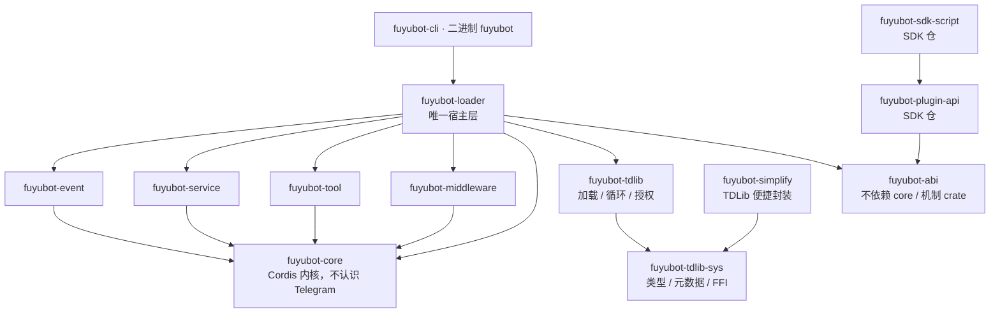
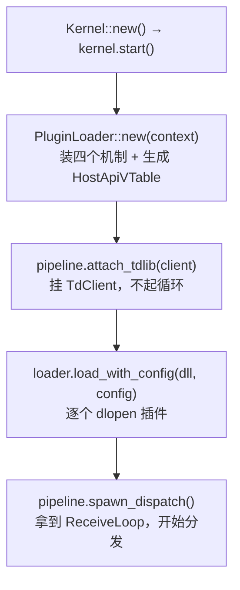
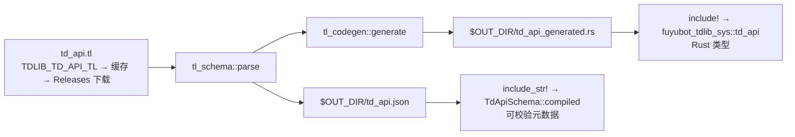

结论先说：**一个宿主进程 + N 个动态库插件（cdylib）**。插件不认识 Rust，只认识 `HostApiVTable`；
宿主是**唯一**实现这张表的 crate（`fuyubot-loader`）。脚本插件（Python / JS / TS）不改变这个结构
——目录形态由两个中间插件（`fuyubot_python_host` / `fuyubot_js_host`）托管，旧的胶水形态
则把解释器子进程藏在自己的 cdylib 里。

本文只讲**结构与数据流**；构建、发布与排错见 [开发文档](/docs/dev/)。

## crate 依赖方向

箭头指向「依赖的那一边」（`A --> B` = A 依赖 B）：



| 边 | 允许吗 |
| --- | --- |
| `fuyubot-core` → `fuyubot-tdlib` | 禁止 |
| `fuyubot-abi` → `fuyubot-core` | 禁止 |
| `event` / `service` / `tool` / `middleware` 互相依赖 | 禁止（彼此不依赖） |
| `fuyubot-tdlib-sys` → 任何 fuyu crate | 禁止（它是最底层） |
| `fuyubot-loader` → 四个机制 + `tdlib` + `abi` + `core` | 允许（**只有它**） |

组合只发生在两处：`HostRuntime::new`（把四个机制 `install` 进 `Context`）与 `HostRuntime` 里的
15 个 `unsafe extern "C"` 桥。四个机制 crate 绝不彼此调用。

## 启动顺序：先 attach TDLib，再 load 插件



为什么不能反过来：`attach_tdlib` 之前 `td_send` 走「没接 TDLib」分支（请求只留档 + 合成请求号，
起点 `1 << 48`），而插件在 `plugin_start` 里就发请求（模板与示例都这样）；分发排在插件加载之后，
否则插件漏订阅。`--replay` / `--no-tdlib` 故意不 attach——回放是离线验证。

## 主链路

```mermaid
graph TD
  P["插件：on / invoke / emit / use_middleware / …"] --> V["HostApiVTable<br/>18 字段 = version / size / host_ctx<br/>+ 15 个函数指针（全 Option，首参 host）"]
  V --> H["HostRuntime：翻译成事件总线 / 服务容器<br/>/ 工具表 / 中间件管线 / TdClient"]
  H -->|"td_invoke* → td_send"| S["TdClient::send（注入 @extra）<br/>没接 TDLib：留档 + 合成请求号"]
  H -->|"td_execute（同步）"| X["TdClient::execute<br/>只给不碰网络的方法用"]
  S --> L["TdClient::spawn_receive_loop → Routed"]
  L --> U["Update → process_value：PreUpdate → 解析 @type<br/>→ PreRoute → InPlugin → 双通道发布 → PostResponse"]
  U --> C1["emit(\"update\", …) 兜底通道"]
  U --> C2["emit(@type, …) 具体通道"]
  L --> R["Response → deliver_response<br/>按 request_id / @extra 找到发起者"]
  R --> S2["emit_scoped(owner, \"response\", …)"]
```

`process`（吃 `&str`）只是 `process_value` 的前半段（解析 JSON 再交给它）；接收循环那条路
本来就有 `Value`，所以走 `process_value`。

| 阶段 | 数值 | 谁跑它 |
| --- | --- | --- |
| `Stage::PreUpdate` / `PreRoute` / `InPlugin` / `PostResponse` | 0 / 1 / 2 / 3 | `UpdatePipeline::process_value` |
| `Stage::PreToolCall` / `PostToolCall` | 4 / 5 | **目前没有生产调用方**（只有 `fuyubot-middleware` 自己的测试） |

六阶段的数值在 `fuyubot-abi::Stage`，与 `fuyubot-middleware::Stage` 一一对应，由 `runtime.rs` 的
`stage_numbers_match_the_middleware_crate` 测试钉住。

三条容易搞错的语义：

- **归属是「额外定向」，不是「排除广播」**：`emit` 发给所有订阅者，`emit_scoped(owner, …)` 是
  「全局 + 该归属」。响应因此对所有插件透明。
- **中间件一条更新跑一遍，不是每个监听器跑一遍**：`InPlugin` 的产出就是所有监听器看到的版本
  （按监听器各跑一遍的话，第 N 个会看到被改过 N 次的 payload）。
- **过滤器里的 `event_type` 键只用来选通道**，不参与负载匹配；等响应写
  `{"event_type":"response","request_id":N}`。

## 注册作用域与卸载

`HostRuntime::plugin_scope()` 给这次加载分配一个 owner id，之后所有跨 ABI 的注册
（订阅 / 工具 / 服务 / 中间件）都记在这个 owner 名下（`RegistrationKind` + `Registration`）。
`scope.commit()` 保留；提前 drop（init 失败、start 报错、ABI 不匹配）或 `LoadedPlugin` 被 drop 时，
`rollback_owner(owner)` 一次性撤掉这批注册；宿主自己（owner 0）不受影响。

`LoadedPlugin` 的字段声明顺序就是卸载顺序：先 `plugin_stop`，再 `rollback_owner`，
最后 `_lib: Library` 才 drop——到这一步动态库才真正卸载。

中间插件要批量托管脚本时，用**内置 scope 服务**（`get_service("fuyubot.host.scope")`）开子作用域：
`create` 出的子作用域从当前作用域栈继承 owner（脱离加载线程的场景——比如 watch 线程——要先建
root scope 再 `enter`，否则 owner 退化成宿主 0，卸载时回滚不到），注册落在子作用域里，
`rollback_scope` 可以只撤这一批；插件卸载时连 owner 一起收。

**唯一的例外是 Go 的 c-shared 库**：它的运行时有线程与信号处理器，卸载后进程会 access violation
（`0xC0000005`，而且崩在退出那一刻）。`PluginLoader` 用文件里的 Go buildinfo 魔数认出 Go 产物，
对这类库 `plugin_stop` 与注册回滚照跑，但**故意不卸载那个 `Library`**，让它映射到进程退出。
代价是「同一进程内反复加载同一个 Go 插件」不可靠（热重载路径），收益是 Go 插件能正常用。

## 两种插件形态

```text
动态库插件（Rust / C / C++）——同一地址空间、同一批线程
  导出 plugin_init / plugin_start / plugin_stop / plugin_free_string；回调 unsafe extern "C-unwind"
  数据不走序列化管道：回调直接收到宿主的临时 NUL 结尾字符串（只在下一次宿主调用前有效）
  代价是共享地址空间（崩了一起崩），收益是零拷贝、零协议

脚本插件（Python / JS / TS）——一个脚本一个解释器子进程
  目录形态（推荐）：中间插件 fuyubot_python_host / fuyubot_js_host 托管，
    每个脚本目录一个子进程（uv sync / bun install 装依赖，uv run / bun 起进程），
    薄 SDK（fuyubot.py / fuyubot.ts）经原生桥（同一份中间插件的 dll）回调宿主
  胶水 cdylib 形态（旧）：script_plugin! 展开出的 cdylib 自己 spawn 解释器，
    脚本与 cdylib 同名同目录（weather.dll ↔ weather.py），stdin/stdout 一行一个 JSON
```

| | 动态库插件 | 脚本插件（目录形态） | 脚本插件（胶水 cdylib） |
| --- | --- | --- | --- |
| 进程 / 边界 | 与宿主同进程；C ABI 函数调用 | 一进程一脚本；经原生桥回调 | 一进程一插件；stdin/stdout 一行一个 JSON |
| 脚本定位 | 不适用 | manifest（`[tool.fuyubot]` / `"fuyubot"`）声明入口 | **脚本必须与 cdylib 同名同目录** |
| 装载 | `plugin install <产物>` | `plugin install <目录>` → `plugins/scripts/` | `plugin install <产物>` |
| 启动时序 / 崩溃 | 同步；崩了拖垮宿主 | 装依赖后起进程，等 `ready`；子进程死，宿主记一条错 | `plugin_start` 阻塞等脚本报 `ready`；同左 |
| 已知天花板 | panic 靠 `C-unwind` + `catch_unwind` 接住 | 改代码不热载（watch 只认目录增删） | 管道是同步写的：脚本一直不读 stdin 会拖住宿主那条线程 |

脚本侧协议见 `fuyubot-sdk-script` 的 crate 文档；目录形态与薄 SDK 见文档站的
[脚本插件](https://catmoecircle.github.io/FuyuBot-docs/docs/plugin/scripts/)。
两门语言共用同一份 Rust 桥，所以「Python SDK 与 JS SDK 对 ABI 的理解」不可能漂移。

## 四大机制与内核

```text
core：lib.rs（Kernel：Created → Started → Stopped）/ context.rs（Arc<RwLock<HashMap<TypeId, Arc<dyn Any + Send + Sync>>>>）
      effect.rs（Box<dyn FnOnce() + Send> 回滚守卫，#[must_use]，merge() 后注册者先撤销）
      plugin.rs（Plugin trait + define_plugin!）/ manager.rs（PluginManager：load/load_all/unload/reload + DFS 三色拓扑排序）
event：EventBus / Filter / SubscriptionHandle / EventContextExt
service：ServiceContainer / ServiceHandle / ServiceContextExt
tool：ToolDescriptor / ToolRegistry / ToolHandle / ffi 模块 / ToolContextExt
middleware：Stage / Middleware / Next / Pipeline / MiddlewareHandle / MiddlewareContextExt
```

共用的三条约定：**回调错误类型由 core 定**（四个 crate 不能互相依赖，所以 `fuyubot_core::Result<T>`
是全仓唯一允许 boxed error 的地方）；**与 Context 的集成 = `install(ctx)` + 扩展 trait**
（返回的 `Effect` 要一直持有，否则服务立刻从 Context 消失）；**所有注册都返回句柄且 `#[must_use]`**
（四个 Handle 内部都包着 `core::Effect`，drop 即回滚）。

- **事件**：`emit` 在锁**外面**调回调，所以回调里再 `on` / `emit` / `off` 不会自锁；某个回调返回
  `Err` 会**中断**本次广播并把错误抛出去。`Filter` 用点分路径（`"message.chat.id"`）做字段相等匹配。
- **服务**：命名容器（跨语言插件报不出 Rust 的 `TypeId`）。同名重复注册报错；`get::<T>` 类型不匹配
  返回 `None`，用 `contains` + `type_of` 区分「没注册」和「类型不对」。
- **工具**：`call_tool` = 查表 → 权限门 → input_schema → 处理器 → output_schema。
  `handler: Option<ToolHandlerFn>`，`None` 表示「只有元数据的声明型工具」；注册/注销用 `on_change`
  广播（**不认识事件系统**，要不要转成事件总线由宿主层做）。
- **中间件**：洋葱模型，`next.run(ctx)` 前是进入段、后是退出段。`run(stage, ctx)` 会**先复制层列表
  再执行**，所以中间件里再 `use_middleware` 不会自锁；不调 `next.run` 就是不往下走。

内核几条语义：**`Context` 只有 `&self`**（`provide` 返回 `Effect`，drop 即注销，必须持有）；
**`Effect::merge` 是 LIFO**（`a.merge(b)` 撤销顺序 `b → a`）；**加载顺序由依赖决定，卸载是加载顺序
的倒序**（`load_all` 报错会把本次已加载的卸掉，不留半加载）；**有依赖者时 `unload` 拒绝**
（`HasDependents`，不级联）；`reload` 能工作是因为管理器存的是 `Arc<dyn Plugin>` 而不是 `Box`。

## 绑定层与运行时（`fuyubot-tdlib-sys` / `fuyubot-tdlib`）

```text
crates/fuyubot-tdlib-sys/  ← 绑定层（-sys）：只出类型，不做加载
  build.rs：必需输入 td_api.tl 的获取 + 编译期两份产物（无条件执行，没有 feature 早退）
  src/：build_support.rs（两个构建脚本共享的缓存/下载设施，#[path] 同一份）
        ffi.rs（函数指针 + 符号名 + 指针形状 const assert）
        tl_schema.rs（解析与 JSON 互转，build.rs 与运行时共用）
        tl_codegen.rs + docs.rs（→ Rust 类型 / TL 标记 → rustdoc）
        schema.rs（TdApiSchema）、td_api.rs（include! 生成物）
crates/fuyubot-tdlib/  ← 运行时半边（依赖并重导出 sys）
  build.rs：只管 vendored 动态库 + 把库 staging 到可执行文件旁边
  src/：loader.rs / loader/vendored.rs / client.rs / authorize.rs
```

`fuyubot_tdlib::` 根上重导出 sys 的 `ffi` / `schema` / `td_api` / `tl_schema` 模块与 `TdApiSchema` /
`EntryKind` / `TlEntry` / `TlParam` / `SchemaError` / `TdApi` / `DEFAULT_LOG_VERBOSITY`——**既有调用方的
路径全部不变**。`src/build_support.rs` 与 `src/loader/vendored.rs` 都被**两边共用**（各自的 build.rs 用
`#[path]` 引同一份源码），所以它们只能依赖 std 与可选依赖；`[package.metadata.fuyubot]` 有两份，值必须
一致（守卫测试 `metadata_is_in_sync_between_the_two_crates`）。

运行时加载优先级（`loader::resolve`）：`TDLIB_TDJSON_PATH` 文件/目录 → **vendored 目录 →
可执行文件所在目录（ExeDir）** → Linux 带版本号系统库 → 裸库名（真去 dlopen 试一次）；全失败返回
`TdlibLoadError::NotFound`，消息里逐条列出 `[1]`…`[4]` 的尝试与原因。真正加载走
`loader::open_library`（Windows 绝对路径走 `LOAD_WITH_ALTERED_SEARCH_PATH`），**不是 `Library::new`**
——新增任何加载动态库的地方都走它。`@extra` 是**字符串**（`RequestId::to_extra()`），`route()`
遇到非数字 `@extra` 会退化成更新而不是 panic。

### `td_api.tl` 转成了什么（**只在编译期**）



两份产物来自同一个解析结果，而且 `tl_schema.rs` 被 build.rs 用 `#[path]` 引同一份实现，所以「编译期
写出来的形状」与「运行时读回去的形状」不可能漂移。生成规则：类 → 带 `#[serde(tag = "@type")]` 的 enum；
函数 → 带 `METHOD` / `RESULT` 常量的 struct（派生 `Default`，没填的字段不写进请求）；类字段一律
`Option<Box<T>>`（断互递归 + 对上「缺字段就是没有」）；认不出的类型降级成 `serde_json::Value`；Rust
关键字转义（`r#type`）；**文档四级齐全**（类 / 变体 / 函数 / 字段）。归类只认
`---functions---` / `---types---` 分区标记，认不出来时**构建直接失败**。
`check_request` 那套元数据仍然保留——它做的是生成类型做不到的本地校验（生成类型只能保证**结构**对，
挡不住「用错方法名」）。

## 关键类型对照

| 类型 / 函数 | 位置 | 作用 |
| --- | --- | --- |
| `HostApiVTable` / `PluginHandle` / `HostApi` | `fuyubot-abi` | 函数表（18 字段） / `plugin_init` 的返回值（`abi_version == 0` = 失败） / 插件侧门面 |
| `HostRuntime` / `UpdatePipeline` / `PluginLoader` / `LoadedPlugin` | `fuyubot-loader` | 15 个桥的落点、请求留档、响应回投、`rollback_owner`；六阶段（实跑 4 个）+ 双通道路由；dlopen 与 drop 即卸载 |
| `TdClient` / `Routed` / `ReceiveLoop` | `fuyubot-tdlib` | TDLib 客户端；`route()` 分出 `Update` / `Response`；停止把手（`stop()` / `join()`，drop **不会**停） |
| `Simplify` / `RichMessage` | `fuyubot-simplify` | 发消息 / 相册 / 编辑 / 删除 / Markdown 转 entities / 等响应 / **富消息**（`rich` 模块，本地 Markdown → 块树）；参数是**每个方法一个结构体** |
| `TdApiSchema::compiled()` | `fuyubot-tdlib-sys` | 编译期烘焙的元数据；`check_request` 做本地方法名/参数名校验 |
