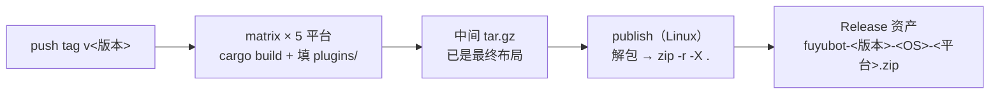

仓库有两套**互不替代**的发布资产，tag 前缀不同，别混：

| 资产 | tag | 生产方 | 谁消费 |
| --- | --- | --- | --- |
| TDLib 动态库 `TDLib-<os>-<arch>` | `TDLib-v<版本>` | `build-tdlib.yml` + `.github/scripts/*.sh` | 构建期（`fuyubot-tdlib` 的 loader 表） |
| fuyubot 本体 `fuyubot-<版本>-<OS>-<平台>.zip` | `v<版本>` | `release-bot.yml` | 终端用户下载、解压即跑 |

## TDLib 资产（构建期契约）

消费方是 `crates/fuyubot-tdlib/src/loader/vendored.rs` 的 `ASSETS` 表，生产方是
`.github/workflows/build-tdlib.yml` 的 matrix；`tests/release_assets.rs` 会**读 workflow 双向比对**，
漂了就红。四条硬要求：

1. tag 必须精确是 **`TDLib-v<版本>`**（下载 URL 由 `release_url()` 拼）；
2. 资产名**精确等于** `ASSETS` 表的值，**不带扩展名**，`<os>-<arch>` 用 cargo 口径（`x86_64` / `aarch64`）；
3. 内容必须是 **`.tar.gz`**（`.zip` 会被 `extract_library` 当裸库原样写出，得到坏文件还不报错）；
4. **加平台只动 `ASSETS` 表 + CI matrix，两边同时加**（`macos/x86_64` 故意不在表里：没有那个 runner）。

## fuyubot 本体（用户下载即用）

运行时仓库的 `release-bot.yml` 在 `v*` tag（或手动 dispatch）上按平台编 `fuyubot-cli` 与三个内置插件，
**构建阶段就把最终布局组好**（`plugins/` 直接填内置插件，不单独打包），每平台出一份中间
`.tar.gz`（已是最终布局）；`publish`（Linux runner）把它转成用户下载的 zip 再挂 Release：



**资产名**：`fuyubot-<版本>-<OS>-<平台>.zip`，例 `fuyubot-v0.1.0-windows-x86_64.zip`。
`<版本>` 取自 tag（分支上手动构建退回 `dev-<sha7>`）；`<OS>` = windows / linux / macos，
`<平台>` = x86_64 / aarch64。名字里带版本，同一页 Release 里多个构建可以并存、一眼可辨。

**zip 解压出来就是本体**——不再套一层目录：

```text
fuyubot.exe / fuyubot
tdjson.dll / libtdjson.so / libtdjson.dylib
plugins/          # 内置插件：/start、/help、/plugins
README.txt
```

`fuyubot-sdk-<os>-<arch>.zip` 由 **SDK 仓库**（`FuyuBot-SDK` 的 `release-sdk.yml`）发布，
不混进运行时的包。

平台集合与 `ASSETS` 表一致：Windows / Linux 各 x86_64 + aarch64，**macOS 只有 aarch64**。

中间产物（每平台一份 `fuyubot-*.tar.gz`）只留在 Actions artifacts 里，**不挂 Release**——
它是构建产物，不是发布形态。

三条契约：**资产名 `fuyubot-<版本>-<OS>-<平台>.zip`**、**zip 解压即本体**（无套层目录）、
**`tdjson` 与可执行文件同级**（靠 loader 优先级 2「可执行文件所在目录」命中）。
zip 只在 `publish`（Linux runner）里生成，Windows runner 的 bash 没有 `zip` 命令。

<Callout type="warn">
  GitHub Actions 在本机验不了。改 workflow 的组包步骤时，把 `Package the runtime` 与
  `Turn each bundle into a flat zip` 两段 bash **原样抠出来在本机跑一次**，
  解压产物验证 `--version` / `init` / `run --replay` / `--no-login --background` 全通——
  这一步是踩过「改了却没验」之后定的规矩。
</Callout>

## 文档站

本站是静态导出（`output: 'export'`），产物 `out/`：

```powershell
pnpm install
pnpm build        # → out/
pnpm preview      # 本地静态服务器预览
```

**push `main` 自动构建并发布到 `gh-pages`**（`pages.yml`；Pages 的 source 是 `gh-pages` 分支）。
GitHub Pages 是项目页（挂在 `/FuyuBot-docs/` 下）：构建前设 `NEXT_PUBLIC_BASE_PATH=/FuyuBot-docs`，
正式域名在**构建前**设 `NEXT_PUBLIC_SITE_URL`（绝对 URL 是烘进产物的）；
`public/.nojekyll` 不能少（`_next/` 以 `_` 开头会被 Jekyll 吞掉）。

发布前过一遍提交检查清单：文档站与运行时仓库里的工程台账都更新、`cargo build/test/fmt` 三条绿、
没把凭据写进任何文件。
