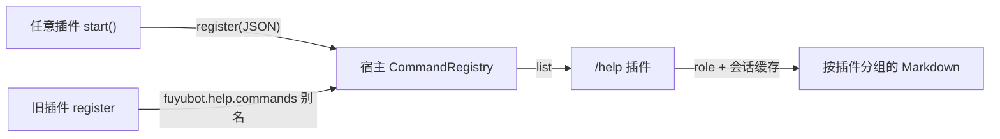

从 0.1.4 起，**命令表的主人是宿主**，不是 `/help` 插件。

插件在 `start()` 里经 `fuyubot.host.commands` 登记；宿主按 owner 管生命周期，
`/help` 只负责读取、过滤和渲染。旧的 `fuyubot.help.commands` 仍保留为**兼容别名**，
指向同一张表。

## 一张图



## 登记命令

```rust
host.call_service(
    "fuyubot.host.commands",
    "register",
    r#"{
        "name": "ban",
        "description": "禁言成员",
        "role": "chat_admin",
        "scopes": ["group"],
        "hidden": false
    }"#,
)?;
```

返回：

```json
{"ok": true, "name": "ban", "plugin": "fuyubot.mod"}
```

`plugin` 由宿主按**调用者栈**判定，入参里没有这个字段，插件伪造不了。
同名命令只允许原 owner 更新；别的插件来登记会被拒绝。

登记失败不影响插件本身的其它功能，但这条命令不会进 `/help`，也不会被能力表保护。

## 字段

| 字段 | 必填 | 默认 | 说明 |
| --- | --- | --- | --- |
| `name` | 是 | — | 不带 `/`，只允许 `a-z0-9_`，统一转小写 |
| `description` | 否 | `""` | `/help` 里那行说明 |
| `role` | 否 | `user` | 最低角色，见下 |
| `scopes` | 否 | `private + group` | 允许出现的会话，见下 |
| `hidden` | 否 | `false` | 不进 `/help`，但仍按能力表执行 |

## `role`

| 值 | 谁能用 |
| --- | --- |
| `user` | 任何能触发命令的人 |
| `chat_admin` | **本会话**的管理员（群主 / 群管理员 / 频道发帖者） |
| `admin` | 全局管理员（`[roles].admins` 或 `[roles].owners`） |
| `owner` | 主人（`[roles].owners`；列表为空时 user 账户默认自己是主人，填了就按列表来） |

兼容写法：`chat-admin`、`chatadmin`。

`owner` / `admin` **不受 `[command].whitelist` 或 `whitelist_only` 影响**：
只要在 `[roles].owners` / `.admins` 里，白名单没写他们也能触发。

判定顺序：

1. `user`：放行；
2. `admin` / `owner`：宿主闸门用配置在**分发前**直接拦；
3. `chat_admin`：优先读对象缓存里的 `ChatMember.status`（30 秒 TTL）；
   缓存没有结论时放行给命令处理器或 `/help` 的回复线程再判；
4. 频道帖子的发送者是频道身份（没有 `user_id`），视为频道管理员。

`admin` / `owner` 是**全局**角色；群里的 Telegram 管理员是**会话**角色，两者不混。

## `scopes`

| 值 | 会话 |
| --- | --- |
| `private` | 私聊 |
| `group` | 群 / 超级群（`supergroup` 也认） |
| `channel` | 频道 |

- 普通命令默认 `private + group`；
- `admin` / `owner` 命令默认**只有 `private`**，要在群里出现必须显式写；
- 频道必须显式写 `channel`，不会从默认值里继承。

宿主闸门优先用缓存里的 `Chat.type` 精确判私聊 / 群 / 频道；缓存没有时才退回
按 `chat_id` 正负粗略判。

## `hidden`

`hidden = true` 只是**不进 `/help`**，不是授权：

- 命令仍在能力表里，`role` / `scopes` 照常生效；
- 适合兼容命令、彩蛋、只给程序调用的命令。

## `/help` 怎么拿到列表

`/help` 调宿主的 `list` 方法：

```rust
let raw = host.call_service("fuyubot.host.commands", "list", "{}")?;
let entries: Vec<serde_json::Value> = serde_json::from_str(&raw)?;
```

`list` 返回**未过滤**的扁平数组：

```json
[
  {
    "name": "start",
    "description": "开始使用",
    "plugin": "fuyubot.start",
    "role": "user",
    "scopes": ["private", "group"],
    "hidden": false
  }
]
```

然后 `/help` 在自己的回复线程里：

1. 调 `role` 拿当前用户的全局角色；
2. 从对象缓存拿会话类型 / 本会话管理员身份；
3. 过滤 `hidden`、`role`、`scopes`；
4. 按 `plugin` 分组，组标题用宿主报告里的 `display_name`，没有就退回短名。

> `list` 是原始表；按人和会话过滤后的“可见命令列表”目前只在 `/help` 内部计算，
> 没有单独的 service 方法。别的插件要复用同一份过滤逻辑时，建议在宿主加一个
> `visible` 方法，而不是自己再拼一遍角色判断。

## 从旧版迁移

### 旧版怎么工作

- `/help` 插件自己持有一个 `REGISTRY`；
- 其它插件调 `fuyubot.help.commands` 的 `register`；
- `start` / `manage` 声明 `soft_inject = ["fuyubot.help.commands"]`，等 help 先起来；
- `/help` 直接读自己的注册表，再和 `BUILTIN_COMMANDS` 静态兜底合并。

### 要改什么

| 旧 | 新 |
| --- | --- |
| `fuyubot.help.commands` | `fuyubot.host.commands` |
| `soft_inject = ["fuyubot.help.commands"]` | 删除；宿主服务启动时就在 |
| `{"name":…,"description":…}` | 可继续只传这两个，`role` / `scopes` / `hidden` 用默认值 |
| help 插件卸载 = 命令表消失 | 命令表在宿主；只有登记它的插件卸载才会摘掉它的条目 |
| 插件卸载后条目可能残留 | 宿主按 owner 整批回滚 |

旧插件不改也能跑：`fuyubot.help.commands` 是宿主的别名，登记进同一张表。
但它只是一个版本的兼容层，新代码请直接用 `fuyubot.host.commands`。

### 行为变化

- **同名冲突**：以前后登记的会覆盖/并存得不明确；现在跨插件同名会被拒绝。
  如果两个插件用了同一个命令名，改名或只保留一个。
- **卸载即消失**：插件卸载 / 加载失败，它登记的命令自动从 `/help` 和能力表里消失。
- **默认角色**：旧登记没有 `role`，按 `user`；没有 `scopes`，按 `private + group`。
- **主人 / 管理员命令默认只进私聊**：要群里用，显式写 `scopes`。
- **静态兜底没了**：`/start`、`/help`、`/plugins` 也由各自插件登记，不再由 help 硬编码。

### 检查清单

- [ ] 把 `fuyubot.help.commands` 改成 `fuyubot.host.commands`。
- [ ] 删掉只为命令登记而写的 `soft_inject`。
- [ ] 给管理类命令补 `role` / `scopes`；主人命令确认是否真的要进群。
- [ ] 确认没有和别的插件重名。
- [ ] 插件卸载后不再依赖旧命令残留。
- [ ] 用 `/help` 在私聊 / 群 / 频道各看一次。

## 相关

- [TDLib 对象缓存](./cache.mdx)
- [插件联动](./linkage.mdx)
- [Simplify](./simplify.mdx)
