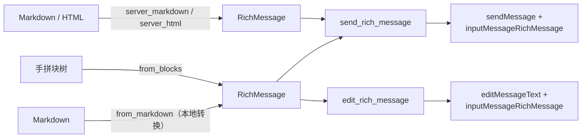

TDLib 的富消息（`messageRichMessage`）是「一页排版」的消息：标题、段落、表格、代码块、
按钮行……全是一块一块的**页块**（`InputPageBlock`），行内另有独立的富文本（`RichText`）。
Bot API 管它叫 [Rich Messages](https://core.telegram.org/bots/api/rich-messages)。

TDLib 里**没有** `sendRichMessage` / `editRichMessage`，也没有自带的 md → 块树转换；
`fuyubot-simplify` 的 `RichMessage` 把这层补齐了：发送 / 编辑就是
`sendMessage` / `editMessageText` + `inputMessageRichMessage`，Markdown 转换在**本地**完成。



## 三种源

`RichMessage` 内部是 `RichSource` 三选一：

| 源 | 构造 | 谁解析 | 谁能发 |
| --- | --- | --- | --- |
| Blocks | `RichMessage::from_markdown(md)` | **本地**转换器（对齐官方 Rich Markdown 全表） | 任何账号 |
| Blocks | `RichMessage::from_blocks(blocks)` | 你给现成块树（每块一条 `InputPageBlock` JSON） | 任何账号 |
| Markdown | `RichMessage::server_markdown(md)` | **服务端**（发前拿不到块树） | 仅 bot |
| Html | `RichMessage::server_html(html)` | **服务端** | 仅 bot |

本地转换器对着[官方 Rich Markdown 表](https://core.telegram.org/bots/api/rich-messages)
一类一例全覆盖：标题 / 段落 / 围栏代码（含 `math`）/ 引用与可展开引用 / 拉引 / 页脚 /
列表与任务项 / 表格 / 分割线 / 公式 / 折叠块 / 拼贴与幻灯片 / 媒体（按扩展名猜类型）/
地图 / 锚点 / 按钮行 / 思考占位 / 脚注；行内粗斜删码、标记、剧透、上下标、行内公式、
自定义 emoji、时间、`mailto:` / `tel:` / `tg://user` / 锚点链接，以及那批 HTML 标签
（`<u>` `<details>` `<tg-collage>` `<tg-button-row>` …）。**不认的一律当普通文本**
（引用式链接、`<table>` 这类 HTML 块不会报错，只是原样保留）。

## 发送与编辑

参数是 `RichMessageParams`——与 `SendMessageParams` **分开的类型**（那边是「文本 + 媒体」
二选一，混在一起互斥规则没人记得住）：`message` / `reply_to_message_id` / `topic_id`
（`Option<Topic>`，见[Simplify 封装](./simplify.mdx#话题topic)）/ `reply_markup` /
`clear_draft` / `timeout_ms`。

和 `Simplify` 的其它方法一样，**等到结果才返回**（详见[调用 TDLib](./tdlib.mdx)）：

| 方法 | 发出的 `@type` | 等到什么 | 返回 |
| --- | --- | --- | --- |
| `Simplify::send_rich_message(chat_id, &RichMessageParams)` | `sendMessage` | 响应 + 发送结局（成功 / 失败） | 最终 `Message`（⚠️ **阻塞**，回调里用 `send_rich_message_then`） |
| `Simplify::edit_rich_message(chat_id, message_id, &RichMessageParams)` | `editMessageText` | 响应 | 改完的 `Message`（回调里用 `edit_rich_message_then`） |

最常用的两条捷径：

```rust
use fuyubot_simplify::{Simplify, RichMessageParams, RichButton};

// Markdown 本地转块树后发送——任何账号都能发
simplify.send_rich_message(chat_id, &RichMessageParams::markdown("# 标题\n\n正文……"))?;

// 同上，末尾一行按钮（按钮在 Markdown 里没有语法，只能显式给）
simplify.send_rich_message(
    chat_id,
    &RichMessageParams::markdown_with_buttons(
        "# 标题\n\n正文……",
        vec![RichButton::url("官网", "https://example.com")],
    ),
)?;
```

## 按钮

按钮在 Markdown 里**没有语法**，一律显式构造：`RichButton::url / callback / user / copy_text`
（`.style(RichButtonStyle)` 换样式），用 `with_buttons` / `with_button_row` 追加
`inputPageBlockButtonRow`。

<Callout type="warn">
  `with_buttons` 只对 **Blocks 源**成立——`server_markdown` / `server_html` 的按钮要用
  服务端语法自己写进文本，对它们调 `with_buttons` 会报 `RichSourceNotBlocks`。
</Callout>

## 行内富文本：`richtext`

块里的行内内容是独立的 `RichText`（31 个构造器，没有 offset/length）：
Markdown 语法能覆盖 21 个，剩下 10 个（`mention` / `hashtag` / `cashtag` /
`bankCardNumber` / `tonAddress` / `botCommand` / `icon` / `button` / `diff` / `anchor`）
没有 md 写法，用 `richtext::*` 拼好塞进块（配合 `with_block`）。

`InputPageBlock` 一共 24 个构造器，本地转换器**全都能产出**（`thinking` 只能出现在草稿消息里，
结构上仍可构造）；`with_block` 也留给「媒体已上传、要传 `inputPhoto` 句柄」这类 md 表达不了的场景。

## 覆盖靠测试钉着

- 块级语法**一类一例**：`block_syntax_covers_the_official_table`（每块都再走一遍
  `td_api::InputPageBlock` 反序列化）；整段全格式回归闸是内联的 `official_sample_fully_deserializes`。
- 加块 / 删块会让 `input_page_block_coverage_is_accounted_for` 失败——24 个构造器的
  分工表就烤在这条测试里。

相关：[调用 TDLib](./tdlib.mdx)（`Simplify` 的其余方法）、[插件总览](./index.mdx)。
