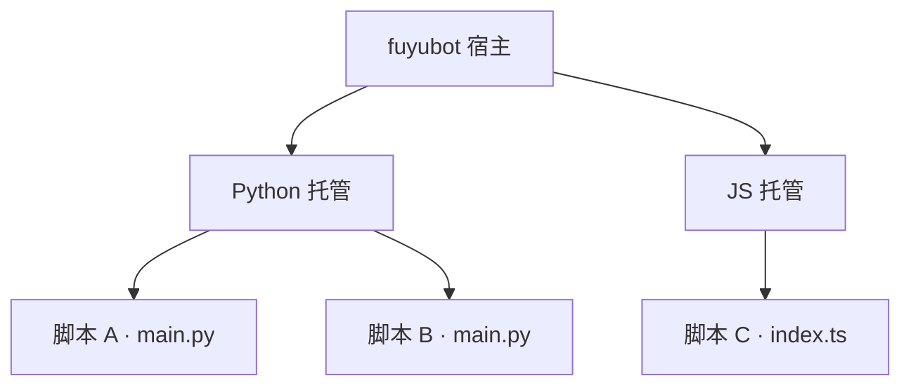
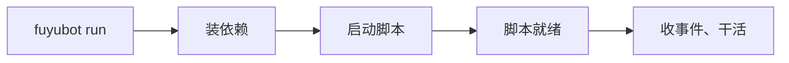

这一页讲**脚本插件**：不编译、不碰 C ABI，用 Python 或 JS / TS 写一个目录，装进机器人就能跑。

```text
my-plugin/
  pyproject.toml 或 package.json   ← 身份（插件叫什么、入口在哪）
  main.py 或 index.ts              ← 你写的逻辑
  fuyubot.py 或 fuyubot.ts         ← 薄 SDK（单文件，拷进来就行）
```

装好之后大概是这样——每个脚本是自己的小进程，坏一个不连累别人：



## 三步上手

### 1. 建目录、写两行

Python 插件的 `pyproject.toml` 里写一段身份（`name` 是插件名，`entry` 不写就默认 `main.py`）：

```toml
[project]
name = "my-plugin"
version = "0.1.0"

[tool.fuyubot]
name = "mybot.my-plugin"
entry = "main.py"
```

JS / TS 插件写在 `package.json` 里（`entry` 不写就默认 `index.ts`）：

```json
{
  "name": "my-plugin",
  "version": "0.1.0",
  "type": "module",
  "fuyubot": { "name": "mybot.my-plugin", "entry": "index.ts" }
}
```

入口文件用薄 SDK 写逻辑。Python 长这样：

```python
from fuyubot import on, log, run

def handle(update):
    log(f"收到新消息 {update['message']['id']}")

on("updateNewMessage", handle)   # 订阅事件
run()                            # 最后一行，永远如此
```

TypeScript 长这样：

```ts
import { on, log, run } from "./fuyubot";

on("updateNewMessage", (update) => {
  log(`收到新消息 ${update.message.id}`);
});

run(); // 最后一行，永远如此
```

薄 SDK 是**一个文件**：Python 拷 `fuyubot.py`、TS 拷 `fuyubot.ts` 进插件目录即可
（随 [FuyuBot-SDK](https://github.com/CatMoeCircle/FuyuBot-SDK) 提供，在
`crates/fuyubot-sdk-native/` 下）。

### 2. 装进机器人

```bash
fuyubot plugin install ./my-plugin
# 已安装 plugins\scripts\my-plugin
```

整个目录被复制到 `plugins/scripts/` 下。想确认装好了：

```bash
fuyubot plugin list
```

### 3. 跑起来

```bash
fuyubot run
```

剩下的交给机器人：装依赖（Python 用 `uv sync`，JS / TS 用 `bun install`）、启动脚本、
开始收事件。流程大致是这样：



## 薄 SDK 能干什么

| 函数 | 干什么 |
| --- | --- |
| `on(事件名, 处理函数)` | 订阅一个事件，来消息时你的函数被调用 |
| `invoke(方法, 参数, 回调?)` | 调一次 TDLib 接口（发消息、取资料……） |
| `log(消息, 级别?)` | 打日志，级别：error / warn / info / debug / trace |
| `emit(事件名, 数据?)` | 发一条自己的事件 |
| `register_tool(...)` / `use_middleware(...)` | 注册工具、挂中间件（进阶，见下文按语言页） |
| `run()` | 握手并开始收事件。**永远放最后一行** |

`on` 收到的 `payload` 是解析好的对象 / 字典，直接取字段就行，不用自己拼 JSON。
更多事件名与接口用法见按语言的页面：

<Cards>
  <Card title="Python 插件" href="/docs/plugin/python/" />
  <Card title="JS 与 TypeScript 插件" href="/docs/plugin/js-ts/" />
  <Card title="订阅与事件" href="/docs/plugin/events/" />
</Cards>

## 装好之后会发生什么

| 你做的 | 机器人的反应 |
| --- | --- |
| `fuyubot plugin install <目录>` | 目录整个拷进 `plugins/scripts/`，下次 `run` 自动加载 |
| 运行中往 `plugins/scripts/` 丢一个新目录 | 约一秒内自动发现、装依赖、启动 |
| 运行中删掉一个脚本目录 | 自动停掉对应脚本（对跑着的实例也安全） |
| 改了脚本里的代码 | **不**自动重启；改完重启机器人即可 |
| `fuyubot plugin uninstall <目录名>` | 删掉目录并卸载脚本 |

<Callout type="info">
  **名字的两副面孔**：manifest 里的 `name`（如 `mybot.my-plugin`）是插件身份，日志里看到的是它；
  `plugin uninstall` 用的是**目录名**（`my-plugin`）。装的时候整个目录一起拷，
  `node_modules` / `.venv` / `target` 这类依赖与构建产物会被跳过——到机器人上现装。
</Callout>

## 两种形态怎么选

| | 脚本插件（本页） | 原生插件 |
| --- | --- | --- |
| 写什么 | Python / JS / TS 脚本 | Rust / C / C++ 编译出的动态库 |
| 要编译吗 | 不要 | 要（用你自己的工具链） |
| 崩了会怎样 | 只有这个脚本的进程死，机器人照常跑 | 可能拖垮整个宿主 |
| 适合 | 机器人逻辑、自动化、小工具 | 高性能、要贴近宿主的场合 |

原生插件是「一个 cdylib 一个插件」的老路子，见 [插件总览](./index.mdx)。

## 常见问题

<Callout type="warn">
  **脚本报「找不到 fuyubot 原生桥库」**：脚本进程要加载 `fuyubot_sdk_native`
  （和托管插件是同一份库）。把它放在插件目录里，或设环境变量
  `FUYUBOT_NATIVE_LIB` 指向它的完整路径，再重启机器人。
</Callout>

- **依赖工具**：Python 要装 [uv](https://docs.astral.sh/uv/)，JS / TS 要装
  [bun](https://bun.sh)。缺了的话对应脚本起不来，日志里会有提示，但不影响机器人启动。
- **托管插件**：`plugins/` 里要有 `fuyubot_python_host` / `fuyubot_js_host`
  两个中间插件（脚本由它们托管），和内置插件放在一起。
- **插件名只允许**字母、数字和 `.` `_` `-`。
- **想排查脚本**：把配置里 `[plugins].log_level` 调成 `"debug"`（见
  [配置文件](../usage/config.mdx)），日志会详细很多。
