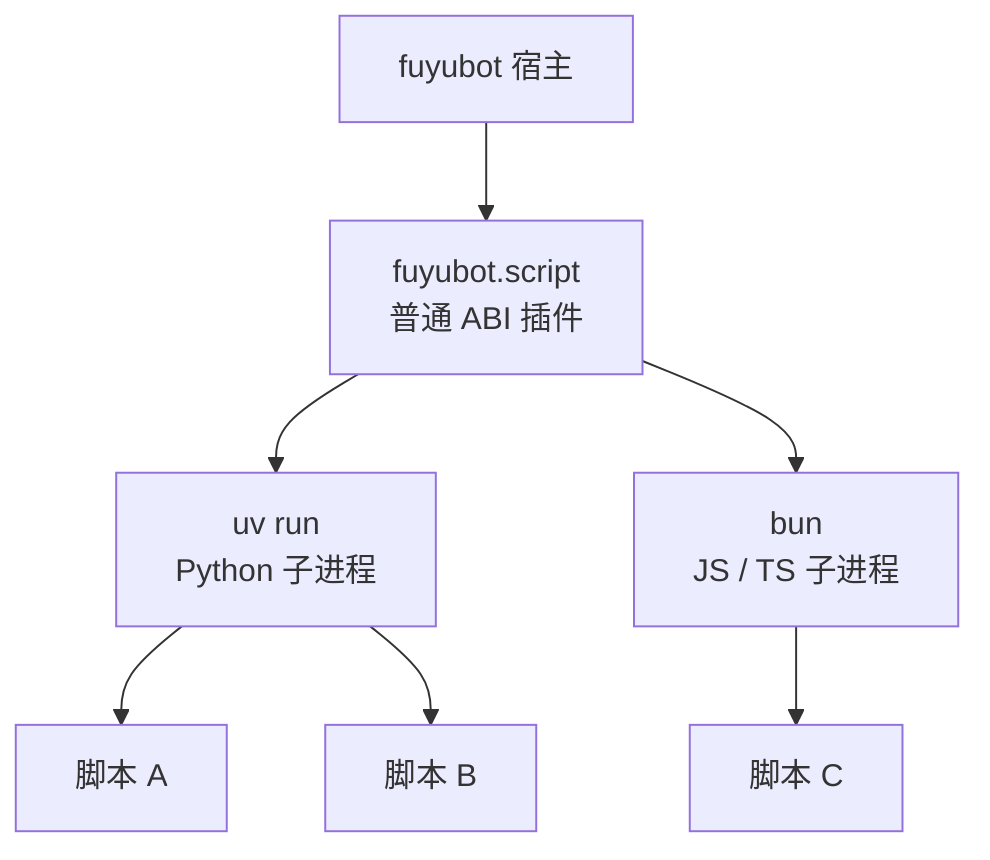

**运行时不认识 Python，也不认识 JavaScript。** 脚本能力**完全由另一个插件提供**：
[FuyuBot-Script](https://github.com/CatMoeCircle/FuyuBot-Script) 打出的 `fuyubot.script`。
它本身就是一个普通的 ABI 插件——装进 `plugins/` 之后，替宿主去扫 `plugins/scripts/`、
给每个脚本起一个子进程、把事件和请求来回搬。

所以这一块和「插件开发」是两件事：

| | 原生插件（[插件开发](../plugin/index.mdx)） | 脚本插件（本板块） |
| --- | --- | --- |
| 谁提供能力 | 运行时本体 | 独立的 `fuyubot.script` 插件 |
| 你写什么 | Rust / C / C++ / Go，编译成 cdylib | Python / JS / TS，一个目录 |
| 要编译吗 | 要 | 不要 |
| 边界 | 与宿主同进程，C ABI | 一个脚本一个解释器子进程 |
| 崩了会怎样 | 可能拖垮宿主 | 只有那个子进程死，宿主记一条错 |

## 它是怎么搭起来的

一个中间插件、两个语言运行时、N 个脚本进程：



- **一个脚本一个进程**：脚本崩溃、死循环、内存涨爆，都只影响它自己。
- **stdio 协议**：脚本的 stdout / stdin 上跑「一行一个 JSON」。薄 SDK 把它包成函数调用，
  作者看不到任何 `op` / `tag` / `handle`。
- **子作用域**：每个脚本的订阅、工具、中间件都落在自己的作用域里，停掉它只撤它自己的注册。

## 装宿主插件

1. 去 [FuyuBot-Script Releases](https://github.com/CatMoeCircle/FuyuBot-Script/releases)
   下载对应平台的 `fuyubot-script-<OS>-<平台>.zip`（例：`fuyubot-script-windows-x86_64.zip`）。
2. 解压，把里面的 `plugins/fuyubot.script/` **整个目录**放进机器人的 `plugins/`。
3. 重启 `fuyubot`。

```text
plugins/
├── fuyubot.script/          ← 宿主插件：plugin.json + fuyubot_script.dll
└── scripts/                 ← 你写的脚本都放这儿
```

`fuyubot plugin list` 的「原生插件包」那一段里能看到 `fuyubot.script`；
「脚本插件」那一段列出 `plugins/scripts/` 里已经装好的脚本。

<Callout type="info">
  运行时发行包里**不带**脚本能力：内置插件只有 `/start`、`/help`、`/plugins` 那几个。
  脚本插件单独发版、单独升级，装与不装都不影响运行时本体。
</Callout>

## 前置条件

<Callout type="warn">
  **uv 和 bun 必须自己先装好**：它们不在运行时发行包里，也不会被自动下载。
  只装了 `fuyubot.script` 却没装对应运行时，那门语言的脚本一律起不来
  （日志里是「找不到 uv / bun」），机器人本体照常跑。
</Callout>

| 语言 | 要装 | 谁在用 |
| --- | --- | --- |
| Python | [uv](https://docs.astral.sh/uv/) | `uv sync` 装依赖，`uv run <entry>` 起脚本 |
| JS / TS | [bun](https://bun.sh)（≥ 1.3.1） | `bun install` 装依赖，`bun <entry>` 起脚本 |

只缺其中一门，只会让那门语言的脚本起不来；机器人本体照常跑，日志里会有提示。

## 写第一个脚本

一个目录就是一个插件，身份写在 manifest 里。Python 用 `pyproject.toml`：

```toml
[project]
name = "weather"
version = "0.1.0"
dependencies = ["fuyubot"]

[tool.fuyubot]
name = "mybot.weather"   # 插件身份，日志里看到的就是它
entry = "main.py"        # 不写就默认 main.py
```

JS / TS 用 `package.json`：

```json
{
  "name": "weather",
  "version": "0.1.0",
  "type": "module",
  "dependencies": { "fuyubot": "^0.1.2" },
  "fuyubot": { "name": "mybot.weather", "entry": "index.ts" }
}
```

入口文件只用薄 SDK，不需要任何构建步骤：

```python
from fuyubot import on, log, run

def on_message(update):
    log(f"新消息 {update['message']['id']}")

on("updateNewMessage", on_message)
run()   # 永远最后一行
```

```ts
import { on, log, run } from "fuyubot";

on("updateNewMessage", (update) => {
  log(`新消息 ${update.message.id}`);
});

run(); // 永远最后一行
```

按语言看完整方法表与示例：

<Cards>
  <Card title="Python 插件" href="/docs/script/python/" />
  <Card title="JS 与 TypeScript 插件" href="/docs/script/js-ts/" />
</Cards>

## 装进机器人

```bash
fuyubot plugin install ./weather
# 已安装 plugins\scripts\weather
```

整个目录被复制到 `plugins/scripts/<目录名>/`。目录名是装卸载的单位，
manifest 里的 `name` 是插件身份——两者不必相同（卸载时用目录名）。

```bash
fuyubot plugin list      # 确认它出现在「脚本插件」那一段
fuyubot run              # 装依赖、起进程、等 ready、开始收事件
```

要把它打成可分发的 zip（带 `plugin.json`、`kind` 写 `python` / `js`），见
[插件分发格式 v1](../plugin/bundle.mdx)。

## 装好之后会发生什么

| 你做的 | 机器人的反应 |
| --- | --- |
| `fuyubot plugin install <目录>` | 整个目录拷进 `plugins/scripts/<目录名>/`，下次 `run` 自动加载 |
| 运行中往 `plugins/scripts/` 丢一个新目录 | 约一秒内发现 → `uv sync` / `bun install` → 起进程 → 等 `ready` |
| 运行中删掉一个脚本目录 | 杀掉对应子进程并撤掉它的注册（跑着的实例上也安全） |
| 改了脚本里的代码 | **不**自动重启；改完重启机器人即可 |
| `fuyubot plugin uninstall <目录名>` | 删掉目录并停掉脚本 |

两个数量级上的细节：

- **启动有 10 秒预算**：`plugin_start` 最多等每个脚本 10 秒报 `ready`，超时算这个脚本失败。
  第一次 `uv sync` / `bun install` 可能更久——先手动装一遍依赖再启动会快很多。
- **只认目录增删，不做热更新**：watch 只比较「顶层有哪些脚本目录」，
  所以 `node_modules` / `.venv` 里的文件风暴不会触发任何动作，代价是改代码必须重启。

<Callout type="warn">
  脚本身份必须能被静态读到：Python 的 `[tool.fuyubot]`、JS 的 `"fuyubot"` 段。
  两样都没有的目录不是插件，`plugin list` 不会列它，`run` 也不会跑它。
</Callout>

## 脚本目录在哪

固定是**插件目录下的 `scripts/`**（默认 `plugins/scripts/`），没有配置项可以改。
想换地方就整体换插件目录（`fuyubot run --plugin-dir …` 或 `[plugins].dir`）。

## 排查

- **`plugin list` 里没有某个脚本**：目录里没有身份段，或者入口文件不在，
  或者它在 `.disabled/` 里。
- **脚本起不来**：先看日志里那条 `ready` 超时/退出码；常见原因是 `uv` / `bun` 没装、
  依赖装不上、入口文件路径写错。
- **「找不到 fuyubot 原生桥库」**：薄 SDK 要加载 `fuyubot_script` 那份 dll。
  宿主起脚本时会自动设 `FUYUBOT_NATIVE_LIB` 指过去，所以**别把 dll 挪出
  `plugins/fuyubot.script/`**；实在要挪就自己设这个变量。
- **改了代码没反应**：不热重载，重启机器人。
- **想看得更细**：把 `[plugins].log_level` 调成 `"debug"`，脚本的 `log()` 会原样转发到宿主日志。
