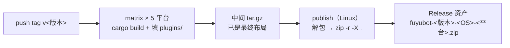

# 发布 (/docs/dev/release)

仓库有三类**互不替代**的发布资产，tag 前缀不同，别混：

| 资产 | tag | 生产方 | 谁消费 |
| --- | --- | --- | --- |
| TDLib 动态库 `TDLib-<os>-<arch>` | `TDLib-v<版本>` | `build-tdlib.yml` + `.github/scripts/*.sh` | 构建期（`fuyubot-tdlib` 的 loader 表） |
| fuyubot 本体 `fuyubot-<版本>-<OS>-<平台>.zip` | `v<版本>` | `release-bot.yml` | 终端用户下载、解压即跑 |
| Android APK `fuyubot-<版本>-<abi>.apk` | `v<版本>` | `release-bot.yml` 的 `build-apk` job | 终端用户直接安装 |

## TDLib 资产（构建期契约） [#tdlib-资产构建期契约]

消费方是 `crates/fuyubot-tdlib/src/loader/vendored.rs` 的 `ASSETS` 表，生产方是
`.github/workflows/build-tdlib.yml` 的 matrix；`tests/release_assets.rs` 会**读 workflow 双向比对**，
漂了就红。四条硬要求：

1. tag 必须精确是 **`TDLib-v<版本>`**（下载 URL 由 `release_url()` 拼）；
2. 资产名**精确等于** `ASSETS` 表的值，**不带扩展名**，`<os>-<arch>` 用 cargo 口径（`x86_64` / `aarch64`）；
3. 内容必须是 **`.tar.gz`**（`.zip` 会被 `extract_library` 当裸库原样写出，得到坏文件还不报错）；
4. **加平台只动 `ASSETS` 表 + CI matrix，两边同时加**（`macos/x86_64` 故意不在表里：没有那个 runner）。

## fuyubot 本体（用户下载即用） [#fuyubot-本体用户下载即用]

运行时仓库的 `release-bot.yml` 在 `v*` tag（或手动 dispatch）上按平台编 `fuyubot-cli` 与三个内置插件，
**构建阶段就把最终布局组好**（`plugins/` 直接填内置插件，不单独打包），每平台出一份中间
`.tar.gz`（已是最终布局）；`publish`（Linux runner）把它转成用户下载的 zip 再挂 Release：



**资产名**：`fuyubot-<版本>-<OS>-<平台>.zip`，例 `fuyubot-v0.1.0-windows-x86_64.zip`。
`<版本>` 取自 tag（分支上手动构建退回 `dev-<sha7>`）；`<OS>` = windows / linux / macos，
`<平台>` = x86_64 / aarch64。名字里带版本，同一页 Release 里多个构建可以并存、一眼可辨。

**zip 解压出来就是本体**——不再套一层目录：

```text
fuyubot.exe / fuyubot
tdjson.dll / libtdjson.so / libtdjson.dylib
plugins/          # 内置插件：/start、/help、/plugins
README.txt
```

脚本插件的 `fuyubot-script-<os>-<arch>.zip` 由 **FuyuBot-Script 仓库**单独发布，
不混进运行时的包。

平台集合与 `ASSETS` 表一致：Windows / Linux 各 x86_64 + aarch64，**macOS 只有 aarch64**。

中间产物（每平台一份 `fuyubot-*.tar.gz`）只留在 Actions artifacts 里，**不挂 Release**——
它是构建产物，不是发布形态。

三条契约：**资产名 `fuyubot-<版本>-<OS>-<平台>.zip`**、**zip 解压即本体**（无套层目录）、
**`tdjson` 与可执行文件同级**（靠 loader 优先级 2「可执行文件所在目录」命中）。
zip 只在 `publish`（Linux runner）里生成，Windows runner 的 bash 没有 `zip` 命令。

### Android：JNI 包（Actions artifact，不进 Release） [#androidjni-包actions-artifact不进-release]

`build-android` job 里还会出一份**只有 `.so`** 的包（不是可执行文件、也不是 APK）：

```text
fuyubot-<版本>-android-jni-<abi>.zip        <abi> = arm64-v8a | x86_64
├─ libfuyubotjni.so      # System.loadLibrary("fuyubotjni")
├─ libtdjson.so
├─ plugins/*.so          # 可选内置插件
├─ include/fuyubot_jni.h
└─ README.txt
```

> ⚠️ 从 2026-11 起这个 zip **不再作为 Release 资产发布**：它只留在 Actions artifacts 里，
> 由同一个 workflow 的 `build-apk` job 取用。Release 页只挂 `.apk`，用户不需要自己拼内核。

`abi` 用的是 **AGP 口径**（`arm64-v8a`），因为这两个 `.so` 要直接进 APK 的
`assets/fuyubot-kernel/`；可执行文件那份包仍用 cargo 口径（`aarch64` / `x86_64`）。
组包与校验在 `.github/scripts/package-fuyubot-jni.sh`：ELF 类型必须是共享库（`ET_DYN`）、
ABI 机器码对得上、`PT_LOAD` 按 16 KB 页对齐、7 个导出符号齐全、`RegisterNatives` 的绑定类名在
（方法名/签名由单测钉住）、`DT_NEEDED` 只允许 bionic 的那几个。
用法见 [Android：JNI 运行时](./android.mdx)。

### Android：APK（可安装的图形客户端） [#androidapk可安装的图形客户端]

同一页 Release 里还有 `.apk`：`fuyubot-<版本>-<abi>.apk`（`<abi>` = `arm64-v8a` / `x86_64`，
例 `fuyubot-v0.1.3-arm64-v8a.apk`）。
它是把上面那个 JNI 包（本次运行的 Actions artifact）塞进壳仓库
[FuyuBot-for-Android](https://github.com/CatMoeCircle/FuyuBot-for-Android)（Kotlin + Compose）再编一次
得到的，内核与本仓**同版本**——`build-apk` job 取的就是本次运行产出的
`fuyubot-<版本>-android-jni-<abi>.zip`，不是上游壳仓库自带的旧内核。

壳不在本仓，按 `main` checkout；内核放的上游**指定目录**是
`app/src/main/assets/fuyubot-kernel/`（不是 `jniLibs/`），由 `.github/scripts/build-android-apk.sh`
铺进去。这个目录被上游 `.gitignore` 排除，缺了它 gradle 照样编得出 APK，只是装到设备上首次启动
报「资产中缺少内核目录」——所以 CI 的判据是**APK 里真有 `assets/fuyubot-kernel/lib*.so`**，
不是「`assembleRelease` 绿了」。

脚本还会按本仓的 tag 与 ABI 改写上游三处常量，不改就会静默出错：

| 上游位置 | 为什么要改 |
| --- | --- |
| `data/update/UpdateChannel.kt` 的 `CURRENT_KERNEL_VERSION` | `KernelManager` 拿它和已装内核比版本，**相等就跳过重装**。不改 = 用户装上新 APK 仍在跑旧内核 |
| `app/build.gradle.kts` 的 `versionCode` / `versionName` | 不改的话每个 Release 都是 `1.0` / `1`，应用内的更新检查永远看不出新版本 |
| `data/plugin/PluginPlatform.kt` 的 `CURRENT_PLUGIN_ABI` | 壳按它挑插件版本；内核换了 ABI 这行没跟上，会装到内核加载不了的插件（或错过能装的旧版本）。发布流程从本仓 `fuyubot_abi::ABI_VERSION` 读出并写入 |

签名走 `apksigner`（`zipalign -P 16` 先对齐再签，minSdk 33 只要 v2 + v3），
keystore 从 Actions Secrets 还原：`ANDROID_KEYSTORE_BASE64` / `ANDROID_KEYSTORE_PASSWORD` /
`ANDROID_KEY_ALIAS` / `ANDROID_KEY_PASSWORD`，四个缺一个这条 job 就失败（宁可不发，也不发装不上的包）。
**同一个 keystore 不能换**——换了老用户装新 APK 会报签名冲突，只能先卸载。
keystore 容器类型按文件魔数判定（PKCS12 是 `30xx` DER、JKS 是 `feedfeed`），与扩展名无关。

<Callout type="warn">
  GitHub Actions 在本机验不了。改 workflow 的组包步骤时，把 `Package the runtime` 与
  `Turn each bundle into a flat zip` 两段 bash **原样抠出来在本机跑一次**，
  解压产物验证 `--version` / `init` / `run --replay` / `--no-login --background` 全通——
  这一步是踩过「改了却没验」之后定的规矩。
</Callout>

## 文档站 [#文档站]

本站是静态导出（`output: 'export'`），产物 `out/`：

```powershell
pnpm install
pnpm build        # → out/
pnpm preview      # 本地静态服务器预览
```

**push `main` 自动构建并发布到 `gh-pages`**（`pages.yml`；Pages 的 source 是 `gh-pages` 分支）。
GitHub Pages 是项目页（挂在 `/FuyuBot-docs/` 下）：构建前设 `NEXT_PUBLIC_BASE_PATH=/FuyuBot-docs`，
正式域名在**构建前**设 `NEXT_PUBLIC_SITE_URL`（绝对 URL 是烘进产物的）；
`public/.nojekyll` 不能少（`_next/` 以 `_` 开头会被 Jekyll 吞掉）。

发布前过一遍提交检查清单：文档站与运行时仓库里的工程台账都更新、`cargo build/test/fmt` 三条绿、
没把凭据写进任何文件。
