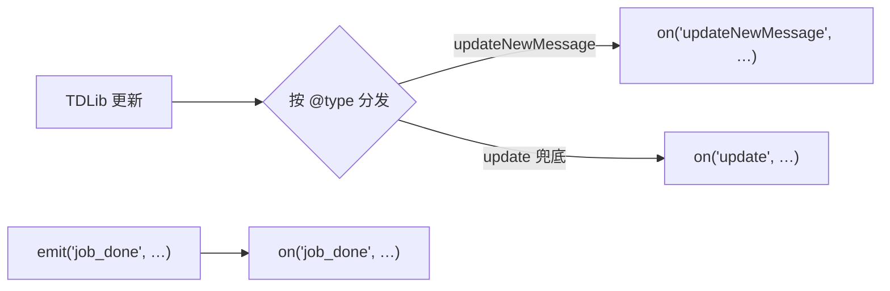

# JS 与 TypeScript 插件 (/docs/plugin/js-ts)

JS / TS 插件就是一个目录：`package.json` 写身份，入口文件写逻辑，`fuyubot.ts`（单文件薄 SDK）
管通信。运行时是 [bun](https://bun.sh)，**TS 不需要 `tsc`**。上手三步见
[脚本插件](./scripts.mdx)。本页是**方法手册 + 示例**。

```text
my-plugin/
  package.json   ← 身份（"fuyubot" 段：name / entry）
  index.ts       ← 你写的逻辑（.js 也行）
  fuyubot.ts     ← 薄 SDK（单文件，拷进来就行）
  fuyubot.d.ts   ← 类型声明（可选，IDE 补全）
```

manifest 长这样（`entry` 不写就默认 `index.ts`）：

```json
{
  "name": "my-plugin",
  "version": "0.1.0",
  "type": "module",
  "fuyubot": { "name": "mybot.my-plugin", "entry": "index.ts" }
}
```

## 方法一览 [#方法一览]

| 方法 | 干什么 |
| --- | --- |
| `on(event, handler, filter?)` | 订阅事件：事件来了就调你的函数 |
| `invoke(method, params?, onResponse?)` | 调一次 TDLib 接口（发消息、取资料……） |
| `emit(event, payload?)` | 发一条自定义事件 |
| `log(message, level = "info")` | 打日志 |
| `registerTool(name, description = "", inputSchema?)` | 登记一个工具 |
| `useMiddleware(stage, handler)` | 挂一个中间件 |
| `pluginConfig()` | **同步**读**自己**那一段配置（`[plugin.<插件名>]`）；`run()` 之前也能用 |
| `getConfig(section, key?, onConfig?)` | 读**任意**插件段（异步，回调在 `run()` 之后） |
| `setConfig(key, value, onDone?)` | 写**自己**那一段配置（成功后回写 `fuyubot.toml`） |
| `run()` | 握手并开始收事件——**永远是最后一行** |

## 读 / 写配置 [#读--写配置]

`fuyubot.toml` 里每个插件有自己的段（见[配置文件](../usage/config.mdx)）。读**自己**那段
用 `pluginConfig()`——它是**同步**的，宿主在启动脚本时就把这段塞进了 `argv[2]`，所以
`run()` 之前（模块顶层）就能用：

```ts
import { on, log, pluginConfig, getConfig, run } from "./fuyubot";

const cfg = pluginConfig(); // { city: "上海" }；没配就是 {}
const city = (cfg.city as string) ?? "北京";

on("updateNewMessage", (payload) => {
  log(`城市 = ${city}`);
  // 读别人的段：异步，回调要等 run() 之后。
  getConfig("my.weather", "city", (value) => log(`天气插件的城市：${JSON.stringify(value)}`));
});

run();
```

```toml
# fuyubot.toml —— 这个段就叫 [plugin.<你的插件名>]
[plugin.fuyubot.js.weather]
city = "上海"
```

- **读别人的段**（`getConfig`）是**异步**的：回执要等 `run()` 之后才有，所以只能在事件/中间件
  回调里用。段或键不存在时回调收到 `null`。
- **写自己的段**（`setConfig`）也是异步的，成功后 `onDone(true)`，宿主会**回写
  `fuyubot.toml`**。⚠️ 回写是**全量重写**，你手写的注释会丢。
- 写失败（越权 / 值不是合法 JSON / 写盘失败）时宿主只发一条 error 日志、**不会**调 `onDone`
  ——别把「没收到回调」当成成功。

<Callout type="info">
  脚本插件只能写**自己**的段：`setConfig` 没有 section 参数，宿主按调用者身份判定归属，
  所以改不到别的插件那一段（会被拒）。这是 ABI 层面的硬约束，不是薄 SDK 的限制。
</Callout>

## 事件怎么触发 [#事件怎么触发]

你的函数只有**被事件触发**才会跑。事件有两个来源：

1. **TDLib 更新**：来一条消息、消息发送成功……每种更新是一个事件，**事件名就是更新的 `@type`**
   （`updateNewMessage`、`updateMessageSendSucceeded` ……）。每条更新会同时发到两个通道：
   具体的 `@type` 事件，和兜底的 `"update"` 事件（订阅它可以看全部）。
2. **你自己发的事件**：`emit("job_done", …)` 发出的自定义事件（细节见
   [订阅与事件](./events.mdx)）。



## `on` — 订阅事件 [#on--订阅事件]

```ts
on(event, handler, filter?)
```

| 参数 | 说明 |
| --- | --- |
| `event` | 事件名：更新的 `@type`、`"update"`（全部更新）或你自定义的名字 |
| `handler` | 回调函数，收到一个 `payload`（解析好的对象，直接取字段） |
| `filter` | 可选。只收负载里**指定字段等于指定值**的事件（点分路径写法，见下） |

同一个事件可以订阅多次，各带各的过滤器。

```ts
import { on, log, run } from "./fuyubot";

const onMessage = (update: any) => {
  log(`新消息 ${update.message.id}`);
};

on("updateNewMessage", onMessage);          // 全收
on("update", () => log("来了一条更新"));      // 兜底通道
run();
```

**过滤器**：`{ "点分路径": 期望值 }`，负载里那个字段**等于**期望值才触发：

```ts
// 只听某个群的消息
on("updateNewMessage", onMessage, { "message.chat_id": -1001234567890 });

// 只听 /hello 命令（文本内容匹配）
on("updateNewMessage", onHello, { "message.content.text.text": "/hello" });
```

## `invoke` — 调 TDLib 接口 [#invoke--调-tdlib-接口]

```ts
invoke(method, params?, onResponse?)
```

发一个 TDLib 请求。方法名与参数名**以 TDLib 为准**（不是 Bot API），查法见
[调用 TDLib](./tdlib.mdx)。给了 `onResponse` 时回调按 `request_id` **自动配对**，
不用自己记请求号。

```ts
import { invoke } from "./fuyubot";

const onMessage = (update: any) => {
  // 发一条文本消息（TDLib 的 sendMessage + inputMessageText）
  invoke("sendMessage", {
    chat_id: update.message.chat_id,
    input_message_content: {
      "@type": "inputMessageText",
      text: { "@type": "formattedText", text: "收到" },
    },
  });
};

// 要看结果就传第三个参数：响应回来自动调它
invoke("getMe", {}, (resp) => console.log("我是", resp));
```

<Callout type="warn">
  `invoke` **不阻塞**、立即返回。响应回来时你的 `onResponse` 被调用。
  不传 `onResponse` 就是「发完不管」。
</Callout>

## `emit` — 发自定义事件 [#emit--发自定义事件]

```ts
emit(event, payload?)
```

给**自己 + 全局订阅者**发一条自定义事件（不是广播给所有插件，见 [订阅与事件](./events.mdx)）。
适合在自己内部做「任务完成」之类的信号：

```ts
on("job_done", (p) => log(`任务完成：${JSON.stringify(p)}`));
emit("job_done", { ok: true });
```

## `log` — 打日志 [#log--打日志]

```ts
log(message, level = "info")
```

`level`：`error` / `warn` / `info` / `debug` / `trace`。排查问题时把配置里
`[plugins].log_level` 调成 `"debug"`（见[配置文件](../usage/config.mdx)）。

```ts
log("普通信息");
log("要坏事了", "warn");
```

## `registerTool` — 登记工具 [#registertool--登记工具]

```ts
registerTool(name, description = "", inputSchema?)
```

只登记**元数据**（名字、说明、参数的 JSON Schema），让宿主知道有这个工具；
调用分发看 [工具与中间件](./tools.mdx)。

```ts
registerTool("weather", "查天气", {
  type: "object",
  properties: { city: { type: "string" } },
  required: ["city"],
});
```

## `useMiddleware` — 挂中间件 [#usemiddleware--挂中间件]

```ts
useMiddleware(stage, handler)
```

`handler(stage, payload)` 在更新流经管线时被调用，可以检查或改写负载。
`stage` 是阶段号；细节看 [工具与中间件](./tools.mdx)。

```ts
const audit = (stage: number, payload: any) => {
  log(`阶段 ${stage} 看到一条更新`);
};

useMiddleware(2, audit);
```

## `run` — 启动 [#run--启动]

```ts
run()
```

发就绪握手、开始收事件，**阻塞到进程结束**。**必须是最后一行**——它提前返回 = 插件加载失败。

## 完整示例 [#完整示例]

**Echo 机器人**——回声复读：

```ts
import { on, invoke, run } from "./fuyubot";

const echo = (update: any) => {
  const message = update.message;
  const text = message?.content?.text?.text ?? "";
  if (!text || message.is_outgoing) return;   // 别回自己发的，否则自激
  invoke("sendMessage", {
    chat_id: message.chat_id,
    input_message_content: {
      "@type": "inputMessageText",
      text: { "@type": "formattedText", text },
    },
  });
};

on("updateNewMessage", echo);
run();
```

**命令处理器**——不同命令各干各的：

```ts
import { on, invoke, run } from "./fuyubot";

const reply = (chatId: number, text: string) =>
  invoke("sendMessage", {
    chat_id: chatId,
    input_message_content: {
      "@type": "inputMessageText",
      text: { "@type": "formattedText", text },
    },
  });

on("updateNewMessage", (u: any) => reply(u.message.chat_id, "你好！"),
  { "message.content.text.text": "/hello" });
on("updateNewMessage", (u: any) => reply(u.message.chat_id, "pong"),
  { "message.content.text.text": "/ping" });
run();
```

**按聊天计数**——记住状态：

```ts
import { on, invoke, run } from "./fuyubot";

const counts = new Map<number, number>();

on("updateNewMessage", (update: any) => {
  const message = update.message;
  if (!message || message.is_outgoing) return;
  const chatId: number = message.chat_id;
  const count = (counts.get(chatId) ?? 0) + 1;
  counts.set(chatId, count);
  invoke("sendMessage", {
    chat_id: chatId,
    input_message_content: {
      "@type": "inputMessageText",
      text: { "@type": "formattedText", text: `本聊天第 ${count} 条消息` },
    },
  });
});

run();
```

## 常见问题 [#常见问题]

- **原生桥**：薄 SDK 要加载原生桥（和托管插件同一份库）。查找顺序：脚本同目录 →
  环境变量 `FUYUBOT_NATIVE_LIB` → 当前工作目录。找不到会报
  「找不到 fuyubot 原生桥库」，排法见 [脚本插件常见问题](./scripts.mdx#常见问题)。
- **自检**：`bun fuyubot.ts` 验证 API 形状（不碰宿主），输出 `fuyubot: self-test ok`。
- **依赖工具**：要装 [bun](https://bun.sh)（机器人用 `bun install` 装依赖、`bun` 起脚本）。
- **payload 取字段**：JS 侧没有 schema，先判空或 `as any` 再取；
  `updateNewMessage` 的文本在 `message.content.text.text`。
