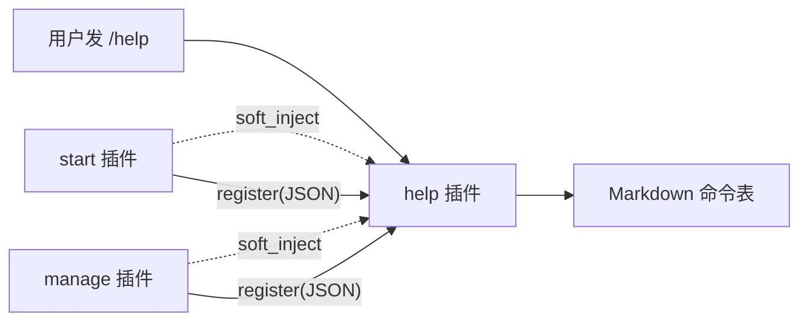

# 插件联动 (/docs/plugin/linkage)

插件之间没有共享的 Rust 类型，也没有彼此的符号表。原生插件（cdylib）跑在同一个进程里，
但只通过宿主的 C ABI 打交道。想「A 把自己的能力借给 B 用」，只有宿主提供的那几条通道。

这篇讲最常用的一条：**命名服务 + 软依赖**。例子就是内置的 `/help`——
它把命令表暴露成一个进程级服务，`fuyubot.start` 和 `fuyubot.manage` 在启动时把自己的命令登记进去，
而它们之间没有一行互相 import 的代码。

## 先选通道 [#先选通道]

| 想做的事 | 通道 | 有返回值 | 对方必须在？ |
| --- | --- | --- | --- |
| 广播「发生了什么」，不关心谁在听 | [事件总线](./events.mdx) `emit` / 订阅 | 否 | 否 |
| 调一个能力，**当场要结果** | 命名服务 `provide_service(_shared)` + `call_service` | 是（JSON 字符串） | 是（调用那一刻） |
| 让宿主 / AI 能发现并调用 | [工具表](./tools.mdx) `register_tool` + `call_tool` | 是 | 是 |
| 只要求「我启动时它已经在了」 | `inject` / `soft_inject` | — | 不负责传值 |

服务适合「一个插件提供能力、其它插件按名字调」：命令注册表、缓存、鉴权、数据源都属于这一类。
它不替代事件——事件是**通知**，服务是**调用**。两者可以叠：服务方法内部照样能 `emit`。

## `/help` 的联动结构 [#help-的联动结构]

内置 `/help` 把命令表暴露成进程级服务 `fuyubot.help.commands`，方法有两个：

| 方法 | 入参 | 返回 |
| --- | --- | --- |
| `register` | `{"name":"start","description":"开始使用"}` | `{"ok":true}`；坏入参回 `{"ok":false,"error":"…"}` |
| `list` | 忽略 | `[{"name":"start","description":"…"}, …]`，即 `/help` 实际渲染的内容 |

服务名建议用反向域名（`fuyubot.help.commands`），方法名用动词；协议字段**只增不改**，
破坏性改动时把 `ServiceVTable.version` 加一（宿主不校验，但调用方可以据此判断）。
坏入参不要 panic——回一个带 `error` 的 JSON，调用方才有机会降级。



三个插件各管一段：

| 角色 | 插件 | 做什么 |
| --- | --- | --- |
| 提供方 | `fuyubot.help` | `start()` 里 `provide_service_shared` 注册服务；`/help` 渲染时合并动态注册表（带归属）与静态基线 |
| 消费方 | `fuyubot.start` | `soft_inject` 声明软依赖；`start()` 里 `call_service(…, "register", …)` |
| 消费方 | `fuyubot.manage` | 同上，登记 `/plugins` |

消费方**不链接** help 插件，也不 import 它的任何代码。它只认两个字符串——服务名和方法名——
外加一份两边都认的 JSON 协议。

> 实例源码在运行时仓库的 `plugins/fuyubot-plugin-help`、`plugins/fuyubot-plugin-start`、
> `plugins/fuyubot-plugin-manage`；这篇只摘和联动有关的部分。

## 提供方：把能力做成服务 [#提供方把能力做成服务]

下面代码用 `fuyubot-abi` 的类型写（三个内置插件就是这么写的）。外部 Rust 插件直接依赖
crates.io 上的 `fuyubot-abi` 即可，拿到的是同一套 `ServiceVTable` / `ServiceMethod` /
`Plugin` / `define_plugin!`。

### 1. 写方法 [#1-写方法]

服务方法只有一个签名：收 JSON、回 JSON（或 `NULL` 表示「成功但没输出」）。

```rust
use std::cell::RefCell;
use std::ffi::{CStr, CString, c_char, c_void};

thread_local! {
    static REPLY: RefCell<CString> = RefCell::new(CString::new("").unwrap());
}

/// 把一段文本放进线程局部缓冲，返回给调用方。
/// 提供方持有返回值：宿主 `call_service` 调完会立刻拷走，不会保存这个指针。
fn reply(text: &str) -> *const c_char {
    let text = CString::new(text).unwrap_or_default();
    REPLY.with(|buffer| {
        *buffer.borrow_mut() = text;
        buffer.borrow().as_ptr()
    })
}

unsafe extern "C" fn svc_register(
    context: *mut c_void,
    input_json: *const c_char,
) -> *const c_char {
    let input = match unsafe { CStr::from_ptr(input_json) }.to_str() {
        Ok(input) => input,
        Err(_) => return reply(r#"{"ok":false,"error":"非 UTF-8"}"#),
    };
    let value: serde_json::Value = match serde_json::from_str(input) {
        Ok(value) => value,
        Err(_) => return reply(r#"{"ok":false,"error":"不是合法 JSON"}"#),
    };
    let Some(name) = value.get("name").and_then(|value| value.as_str()) else {
        return reply(r#"{"ok":false,"error":"缺 name"}"#);
    };
    if name.is_empty() {
        return reply(r#"{"ok":false,"error":"name 为空"}"#);
    }
    // 归属由**宿主**判：问一句「现在是谁在调我」（`current_plugin`），
    // 插件没法把自己冒充成别人。v6 起这次调用经过宿主，所以调用方即使在
    // 自己的线程上调进来也认得出；宿主自己调时是 `None`。
    let plugin = if context.is_null() {
        None
    } else {
        // SAFETY: 提供方把 `vtable.context` 指向自持的 `Box<HostApi>`（见下面的打包）。
        unsafe { &*(context as *const HostApi) }.current_plugin()
    };
    // …把 name / description / plugin 放进自己的注册表…
    match plugin {
        Some(plugin) => reply(&format!(r#"{{"ok":true,"plugin":"{plugin}"}}"#)),
        None => reply(r#"{"ok":true,"plugin":null}"#),
    }
}

/// `list` 方法：把自己的注册表序列化成 JSON 数组。
unsafe extern "C" fn svc_list(
    _context: *mut c_void,
    _input_json: *const c_char,
) -> *const c_char {
    // 实际实现里读注册表、`serde_json::to_string` 之后交给 `reply`。
    reply("[]")
}
```

方法跑在**调用方线程**上。消费方若在命令回调（接收循环线程）里调它，这里就不能做慢事——
否则整个宿主一起卡住。要慢慢做的活，在方法里排个队、立刻返回。

⚠️ `ServiceMethodFn` 是 `extern "C"`，**方法里不能有 panic**：逃出这个边界的 panic 会直接
abort 整个宿主，不是只挂你的插件。解析失败回 `{"ok":false,"error":"…"}`；确实可能 panic 的
代码段自己 `catch_unwind`。

### 2. 打包 VTable 与它引用的缓冲 [#2-打包-vtable-与它引用的缓冲]

`ServiceVTable` 里全是裸指针：`name` 指向服务名，`methods` 指向方法数组，每个方法项又指向
自己的名字。这些缓冲必须和 VTable **活一样久**，所以打包进同一个结构体，一起放进 `Box`：

```rust
use std::ffi::CString;
use fuyubot_abi::{HostApi, ServiceMethod, ServiceVTable};

struct HelpService {
    // 服务方法回问「谁在调我」用的宿主句柄；单独 Box 一层保证地址稳定。
    #[allow(dead_code)]
    host: Box<HostApi>,
    vtable: ServiceVTable,
    // 代码里不读这两个字段，但 vtable 的裸指针指向它们的堆缓冲：
    // 必须和 vtable 同生共死，所以靠「持有」保活。
    #[allow(dead_code)]
    methods: Vec<ServiceMethod>,
    #[allow(dead_code)]
    names: Vec<CString>,
}

fn build_service(host: HostApi) -> Box<HelpService> {
    let names = vec![
        CString::new("fuyubot.help.commands").unwrap(),
        CString::new("register").unwrap(),
        CString::new("list").unwrap(),
    ];
    let methods = vec![
        ServiceMethod { name: names[1].as_ptr(), func: Some(svc_register) },
        ServiceMethod { name: names[2].as_ptr(), func: Some(svc_list) },
    ];
    let host = Box::new(host);
    let vtable = ServiceVTable {
        name: names[0].as_ptr(),
        version: 1,
        size: core::mem::size_of::<ServiceVTable>() as u32,
        // 指进 Box 的堆内存：外层 HelpService 搬家也不会让这个地址失效。
        context: (&*host as *const HostApi).cast_mut().cast::<c_void>(),
        methods: methods.as_ptr(),
        method_count: methods.len(),
    };
    Box::new(HelpService { host, vtable, methods, names })
}
```

这里有几个容易写错的点：

- `Vec` 的**堆缓冲**在结构体移动时不会跟着搬，所以 `Box::new` 之后 `names[i].as_ptr()` /
  `methods.as_ptr()` 仍然有效。**别在注册之后再 `push`**——重新分配会让宿主手里的指针悬空。
- `version` 是提供方自己的协议版本，宿主**不校验**；它只用于调用方自己判断。
- `context` 会原样传给每个方法。需要实例状态就把 `self` 指针放这里；`/help` 用它放
  **宿主句柄**（`HostApi`），注册时才能回问「谁在调我」——这是 `plugin_init` 交给你的那份
  `HostApi`，`Copy` 且可以跨线程，配套的 `Box` 只是为了让地址稳定。

### 3. `start()` 注册，`stop()` 放下 [#3-start-注册stop-放下]

```rust
impl Plugin for HelpPlugin {
    fn start(&mut self, _config_json: &str) -> Result<(), String> {
        // 把 `HostApi` 一起打包进服务：`register` 要靠它问出调用者是谁。
        let service = build_service(self.host);
        let handle = self
            .host
            .provide_service_shared("fuyubot.help.commands", &service.vtable);
        if !handle.is_valid() {
            self.host.log(
                LogLevel::Error,
                "注册 fuyubot.help.commands 失败（同名服务已存在？）",
            );
        }
        // 持有到 stop：vtable 里的指针全都指向它。
        self.service = Some(service);
        Ok(())
    }

    fn stop(&mut self) {
        // 放下即释放；宿主随后按 owner 整批回滚服务注册（顺序是 stop → rollback）。
        self.service = None;
    }
}
```

<Callout type="warn">
  **跨插件共享必须用 `provide_service_shared`。** `provide_service` 写的是调用者自己的
  子作用域，兄弟插件沿父链往上看不到它；两个插件各注册一份同名私有服务也不会冲突，
  但也就谈不上联动。`_shared` 写进程级的根表，同名会和别人撞——所以它必须显眼。
</Callout>

<Callout type="info">
  `ServiceHandle` **不是** RAII：它没有 `Drop`，丢在一边不会注销。正常也不需要手动注销——
  插件卸载时宿主按 owner 回滚它注册的一切，共享服务也一样（写在根表也记得 owner）。
  这里的 `Option<Box<HelpService>>` 只是为了**保活 VTable**，不是为了「用句柄控制注册」。
</Callout>

### 4. 提供方也要能单独活 [#4-提供方也要能单独活]

`/help` 的静态基线 `BUILTIN_COMMANDS` 始终包含 `start` / `help` / `plugins` 三个命令；
动态注册表**优先**（它带宿主判定的归属），静态基线只补缺。所以：

- 没有消费方登记命令，`/help` 仍然列得出内置三件套（只是不标归属）；
- 消费方没起来，只是少几条带归属的动态条目，不会让 `/help` 整个失效。

这是可选联动的通用做法：**提供方给自己留一份能独立工作的兜底**，别把「有人来调我」
当成自己启动的前提。

## 消费方：按名字调用 + 软依赖 [#消费方按名字调用--软依赖]

`fuyubot.start` 的接线只有两段：`start()` 里调服务，`soft_inject()` 里声明排队偏好。

```rust
impl Plugin for StartPlugin {    fn start(&mut self, _config_json: &str) -> Result<(), String> {
        // …订阅 /start…

        // 经共享服务把自己的命令登记进 /help。
        // 失败也不影响 /start 本身：/help 有静态兜底，这里只是少一条动态登记。
        match self.host.call_service(
            "fuyubot.help.commands",
            "register",
            r#"{"name":"start","description":"开始使用"}"#,
        ) {
            Ok(reply) => self
                .host
                .log(LogLevel::Info, &format!("start 已向 /help 登记命令：{reply}")),
            Err(error) => self.host.log(
                LogLevel::Warn,
                &format!("start 登记命令到 /help 失败（继续跑）：{error}"),
            ),
        }

        Ok(())
    }

    fn soft_inject() -> Vec<String> {
        vec!["fuyubot.help.commands".to_owned()]
    }
}
```

`call_service` 是普通安全函数，返回 `Result<String, AbiError>`：

- 服务不存在 / 方法不存在 / 方法指针是 `None` → `Err`；
- 方法返回 `NULL` → `Ok(String::new())`（「成功但没输出」）；
- 方法返回字符串 → 立刻拷成 `String`，调用方拿到的是自己的一份，可以随便留着。

⚠️ 目前错误类型不细分「服务不存在」和「没有这个方法」，都是 `AbiError::BadString`。
所以日志里要把服务名、方法名一起打出来，否则排查时只看得到一句「失败了」。

### `soft_inject` 做了什么、没做什么 [#soft_inject-做了什么没做什么]

宿主在 `plugin_init` **之前**读 `plugin_manifest` 里的依赖列表（`define_plugin!` 会把
`Plugin::soft_inject()` 写进去）。同步阶段分两轮：

1. 先激活「硬依赖齐 **且** 软依赖也齐」的插件；
2. 再激活「只有硬依赖齐」的插件。

所以同一批加载时，只要 help 能正常起来，它一定先于 `/start` 和 `/plugins` 激活——
不管文件名的字典序怎样。

但它**不是**「提供方一定在」的保证：

- 如果 help 自己卡在硬依赖上（停在 `Pending`），消费方的软依赖就不算齐，第二轮照样会激活
  消费方。这时 `call_service` 会失败。
- 如果 help 的 `start()` 报错（`Failed`），软依赖同样不阻塞消费方。
- 运行期中提供方被卸载，消费方仍然处于 `Active`、不会重新跑 `start()`；之后的每次调用
  都要自己处理错误。

一句话：**软依赖管排队，不管可用性**。所以上面的 `match` 分支不是客套，是必须的。

### 软依赖写服务名还是插件名？ [#软依赖写服务名还是插件名]

`inject` / `soft_inject` 里的名字，宿主认两种：

| 写法 | 宿主查什么 | 什么时候用 |
| --- | --- | --- |
| 服务名（`"fuyubot.help.commands"`） | 根作用域的 `Context` 里有没有这个名字 | 推荐。换一个插件提供同名服务，排序仍然成立 |
| 插件名（`"fuyubot.help"`） | 有没有同名插件处于 `Active` | 只关心「那个插件」而不是「那个能力」时 |

⚠️ 软依赖写**私有**服务名是排不上序的：兄弟插件看不到它，管理器在根作用域里也查不到。
跨插件的能力一律走 `provide_service_shared`，依赖也写同一个服务名。

### 软还是硬？ [#软还是硬]

| 场景 | 选择 |
| --- | --- |
| 没有 `/help` 也要能跑，只是少一条登记 | `soft_inject` + 运行期降级 |
| 没有数据库 / 鉴权就完全没意义，宁可别启动 | `inject`（硬依赖） |
| 只要求「它先起来」，不直接调它的服务 | `soft_inject` 写插件名 |
| 能力名稳定、可能有替代提供者 | `soft_inject` 写服务名 |

硬依赖的语义是**准入**：缺了就不激活，停在 `Pending` 等；如果提供它的插件已经 `Failed`，
依赖方会被级联标成 `Failed`，而不是永远假装在等。但它也不传值——到了 `start()` 里，
你仍然要自己 `get_service` / `call_service`。

依赖声明不要写进配置：manifest 是权威来源，`define_plugin!` 从 trait 自动生成。
只有没有 `plugin_manifest` 的 v3 老插件，宿主才回退到 `[plugin.<名字>].inject` /
`.soft_inject`（manifest 该侧非空时**覆盖**配置，不是合并）。见[插件总览](./index.mdx#声明依赖inject-与-soft_inject)。

## 生命周期与所有权 [#生命周期与所有权]

| 事 | 规则 |
| --- | --- |
| 什么时候注册 | `start()`。`init()` 阶段插件还没被准入，别在那时对外暴露能力 |
| 注册进宿主的是什么 | 裸指针，**不复制**。VTable 和它引用的字符串 / 方法数组必须一直活着 |
| 什么时候释放 | `plugin_stop` 先跑，然后宿主 `rollback_owner` 撤销注册。`stop()` 里放下 `Box` 即可 |
| 同名冲突 | `provide_service_shared` 返回无效句柄，宿主只打一条 `warn`；调用方必须检查 `is_valid()` |
| 方法返回值 | 提供方持有，宿主当场拷走；不要跨调用保存那个指针 |
| `get_service` 的指针 | 同样是借的。别长期缓存——提供方一旦卸载，指针就悬空 |
| 方法在哪跑 | 调用方线程，同步执行。命令回调里调服务 = 在接收循环线程上跑，不能阻塞 |
| 输入可信吗 | 共享服务任何插件都能调。方法里自己校验 JSON、限制大小、别信 `context` 之外的东西 |

## 其它语言 [#其它语言]

| 语言 | 提供方 | 消费方 |
| --- | --- | --- |
| Rust | `provide_service` / `provide_service_shared` | `call_service`，或 `get_service` + 自己扫方法表 |
| C / C++ | VTable 里第 9 / 20 项 | `get_service` + 按 `method_count` 扫 `methods[i]` |
| Go | 同上（c-shared 不能卸载，见 ABI 页） | 同上 |
| Python / JS / TS | 暂不支持 | 薄 SDK 还没暴露服务调用，见[脚本插件](../script/index.mdx) |

C 侧的字段布局与调用示例见 [插件 ABI](./abi.mdx#服务的形状servicevtable) 和
[原生插件](./native.mdx)。

## 排查 [#排查]

- `/help` 里少了一条命令：先看 `start` / `manage` 的日志有没有
  `… 已向 /help 注册命令：{"ok":true}`；失败那条会带 `call_service` 的错误。
- 服务注册失败：宿主日志里有一行 `注册共享服务 … 失败: 命名服务 … 已经注册过了`
  （或「收到了空 vtable」）。
- 谁在跑、谁在等：`/plugins` 走宿主预置的 `fuyubot.host.plugins` 服务，会列出
  `active` / `pending`（带 `missing`）/ `failed`（带 `reason`）；`fuyubot status` 读的是
  实例发布的同一份快照（摘要 + pending / failed 明细）。
- 依赖声明从哪来：`plugin_manifest`。激活时日志里那行
  `激活 <名字> v<版本>（硬依赖 N、软依赖 M）` 就是宿主实际读到的数量；`status` 里的
  `pending` / `missing` 也是按它算的。别只改配置——manifest 非空时配置那份会被覆盖。

## 一页检查清单 [#一页检查清单]

- [ ] 提供方用 `provide_service_shared`，方法名和 JSON 协议写进文档。
- [ ] VTable、方法数组、名字缓冲装在同一个 `Box` 里，注册后不再扩容。
- [ ] 检查 `ServiceHandle::is_valid()`；`stop()` 里放下持有物，不手动 free 宿主的东西。
- [ ] 消费方对 `call_service` 的失败有降级分支，不 `unwrap`。
- [ ] 可选联动用 `soft_inject`，并接受「提供方可能不在」；缺了就活不了才用 `inject`。
- [ ] 方法里不做慢活、不阻塞调用方线程；也不让 panic 逃出 `extern "C"` 边界。
