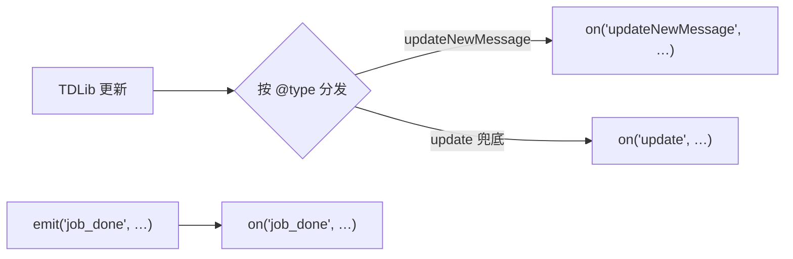

# Python 插件 (/docs/plugin/python)

Python 插件就是一个目录：`pyproject.toml` 写身份，`main.py` 写逻辑，`fuyubot.py`（单文件薄 SDK）
管通信。上手三步见 [脚本插件](./scripts.mdx)。本页是**方法手册 + 示例**。

<Callout type="info">
  本页的 `fuyubot.py`（`fuyubot-python-host`）和 `script_plugin!` 内嵌的
  `fuyubot_plugin.py` 都支持 `run_async` / `invoke_async` / `wait_async`，
  见 [异步等待](./async.mdx)。
</Callout>

```text
my-plugin/
  pyproject.toml   ← 身份（[tool.fuyubot]：name / entry）
  main.py          ← 你写的逻辑
  fuyubot.py       ← 薄 SDK（单文件，拷进来就行）
  fuyubot.pyi      ← 类型声明（可选，IDE 补全）
```

manifest 长这样（`entry` 不写就默认 `main.py`）：

```toml
[project]
name = "my-plugin"
version = "0.1.0"

[tool.fuyubot]
name = "mybot.my-plugin"
entry = "main.py"
```

## 方法一览 [#方法一览]

| 方法 | 干什么 |
| --- | --- |
| `on(event, handler, filter=None)` | 订阅事件：事件来了就调你的函数 |
| `invoke(method, params=None, on_response=None)` | 调一次 TDLib 接口（发消息、取资料……） |
| `emit(event, payload=None)` | 发一条自定义事件 |
| `log(message, level="info")` | 打日志 |
| `register_tool(name, description="", input_schema=None)` | 登记一个工具 |
| `use_middleware(stage, handler)` | 挂一个中间件 |
| `plugin_config()` | **同步**读**自己**那一段配置（`[plugin.<插件名>]`）；`run()` 之前也能用 |
| `get_config(section, key="", on_config=None)` | 读**任意**插件段（异步，回调在 `run()` 之后） |
| `set_config(key, value, on_done=None)` | 写**自己**那一段配置（成功后回写 `fuyubot.toml`） |
| `run()` | 握手并开始收事件——**永远是最后一行** |

## 读 / 写配置 [#读--写配置]

`fuyubot.toml` 里每个插件有自己的段（见[配置文件](../usage/config.mdx)）。读**自己**那段
用 `plugin_config()`——它是**同步**的，宿主在启动脚本时就把这段塞进了 `argv[2]`，所以
`run()` 之前（模块顶层）就能用：

```python
import fuyubot_plugin as host

cfg = host.plugin_config()              # {"city": "上海"}；没配就是 {}
city = cfg.get("city", "北京")

@host.on("updateNewMessage")
def on_message(payload):
    host.log(f"城市 = {city}")
    host.get_config("my.weather", "city", lambda value: host.log(f"天气插件的城市：{value}"))

host.run()
```

```toml
# fuyubot.toml —— 这个段就叫 [plugin.<你的插件名>]
[plugin.fuyubot.python.weather]
city = "上海"
```

- **读别人的段**（`get_config`）是**异步**的：回执要等 `run()` 之后才有，所以只能在事件/中间件
  回调里用。段或键不存在时回调收到 `None`。
- **写自己的段**（`set_config`）也是异步的，成功后 `on_done(True)`，宿主会**回写
  `fuyubot.toml`**。⚠️ 回写是**全量重写**，你手写的注释会丢。
- 写失败（越权 / 值不是合法 JSON / 写盘失败）时宿主只发一条 error 日志、**不会**调 `on_done`
  ——别把「没收到回调」当成成功。

<Callout type="info">
  脚本插件只能写**自己**的段：`set_config` 没有 section 参数，宿主按调用者身份判定归属，
  所以改不到别的插件那一段（会被拒）。这是 ABI 层面的硬约束，不是薄 SDK 的限制。
</Callout>

## 事件怎么触发 [#事件怎么触发]

你的函数只有**被事件触发**才会跑。事件有两个来源：

1. **TDLib 更新**：来一条消息、消息发送成功……每种更新是一个事件，**事件名就是更新的 `@type`**
   （`updateNewMessage`、`updateMessageSendSucceeded` ……）。每条更新会同时发到两个通道：
   具体的 `@type` 事件，和兜底的 `"update"` 事件（订阅它可以看全部）。
2. **你自己发的事件**：`emit("job_done", …)` 发出的自定义事件（细节见
   [订阅与事件](./events.mdx)）。



## `on` — 订阅事件 [#on--订阅事件]

```python
on(event, handler, filter=None)
```

| 参数 | 说明 |
| --- | --- |
| `event` | 事件名：更新的 `@type`、`"update"`（全部更新）或你自定义的名字 |
| `handler` | 回调函数，收到一个 `payload`（解析好的 `dict`，直接取字段） |
| `filter` | 可选。只收负载里**指定字段等于指定值**的事件（点分路径写法，见下） |

**是两参数函数，不是装饰器**——`@on(...)` 会报错，老老实实 `on(事件, 函数)`。
同一个事件可以订阅多次，各带各的过滤器。

```python
from fuyubot import on, log, run

def on_message(update):
    log(f"新消息 {update['message']['id']}")

on("updateNewMessage", on_message)          # 全收
on("update", lambda u: log("来了一条更新"))   # 兜底通道
run()
```

**过滤器**：`{"点分路径": 期望值}`，负载里那个字段**等于**期望值才触发：

```python
# 只听某个群的消息
on("updateNewMessage", on_message, {"message.chat_id": -1001234567890})

# 只听 /hello 命令（文本内容匹配）
on("updateNewMessage", on_hello, {"message.content.text.text": "/hello"})
```

## `invoke` — 调 TDLib 接口 [#invoke--调-tdlib-接口]

```python
invoke(method, params=None, on_response=None)
```

发一个 TDLib 请求。方法名与参数名**以 TDLib 为准**（不是 Bot API），查法见
[调用 TDLib](./tdlib.mdx)。给了 `on_response` 时回调按 `request_id` **自动配对**，
不用自己记请求号。

```python
from fuyubot import invoke

def on_message(update):
    # 发一条文本消息（TDLib 的 sendMessage + inputMessageText）
    invoke("sendMessage", {
        "chat_id": update["message"]["chat_id"],
        "input_message_content": {
            "@type": "inputMessageText",
            "text": {"@type": "formattedText", "text": "收到"},
        },
    })

# 要看结果就传第三个参数：响应回来自动调它
invoke("getMe", {}, lambda resp: print("我是", resp))
```

<Callout type="warn">
  `invoke` **不阻塞**、立即返回。响应回来时你的 `on_response` 被调用。
  不传 `on_response` 就是「发完不管」。
</Callout>

## `emit` — 发自定义事件 [#emit--发自定义事件]

```python
emit(event, payload=None)
```

给**自己 + 全局订阅者**发一条自定义事件（不是广播给所有插件，见 [订阅与事件](./events.mdx)）。
适合在自己内部做「任务完成」之类的信号：

```python
on("job_done", lambda p: log(f"任务完成：{p}"))
emit("job_done", {"ok": True})
```

## `log` — 打日志 [#log--打日志]

```python
log(message, level="info")
```

`level`：`error` / `warn` / `info` / `debug` / `trace`。排查问题时把配置里
`[plugins].log_level` 调成 `"debug"`（见[配置文件](../usage/config.mdx)）。

```python
log("普通信息")
log("要坏事了", "warn")
```

## `register_tool` — 登记工具 [#register_tool--登记工具]

```python
register_tool(name, description="", input_schema=None)
```

只登记**元数据**（名字、说明、参数的 JSON Schema），让宿主知道有这个工具；
调用分发看 [工具与中间件](./tools.mdx)。

```python
register_tool("weather", "查天气", {
    "type": "object",
    "properties": {"city": {"type": "string"}},
    "required": ["city"],
})
```

## `use_middleware` — 挂中间件 [#use_middleware--挂中间件]

```python
use_middleware(stage, handler)
```

`handler(stage, payload)` 在更新流经管线时被调用，可以检查或改写负载。
`stage` 是阶段号；细节看 [工具与中间件](./tools.mdx)。

```python
def audit(stage, payload):
    log(f"阶段 {stage} 看到一条更新")

use_middleware(2, audit)
```

## `run` — 启动 [#run--启动]

```python
run()
```

发就绪握手、开始收事件，**阻塞到进程结束**。**必须是最后一行**——它提前返回 = 插件加载失败。

## 完整示例 [#完整示例]

**Echo 机器人**——回声复读：

```python
from fuyubot import on, invoke, log, run

def echo(update):
    message = update.get("message") or {}
    content = message.get("content") or {}
    text = (content.get("text") or {}).get("text", "")
    if not text or message.get("is_outgoing"):
        return   # 别回自己发的，否则自激
    invoke("sendMessage", {
        "chat_id": message["chat_id"],
        "input_message_content": {
            "@type": "inputMessageText",
            "text": {"@type": "formattedText", "text": text},
        },
    })

on("updateNewMessage", echo)
run()
```

**命令处理器**——不同命令各干各的：

```python
from fuyubot import on, invoke, run

def reply(chat_id, text):
    invoke("sendMessage", {
        "chat_id": chat_id,
        "input_message_content": {
            "@type": "inputMessageText",
            "text": {"@type": "formattedText", "text": text},
        },
    })

def on_hello(update):
    reply(update["message"]["chat_id"], "你好！")

def on_ping(update):
    reply(update["message"]["chat_id"], "pong")

on("updateNewMessage", on_hello, {"message.content.text.text": "/hello"})
on("updateNewMessage", on_ping,  {"message.content.text.text": "/ping"})
run()
```

**看全部流量**——兜底通道记日志：

```python
from fuyubot import on, log, run

on("update", lambda u: log(f"更新：{u.get('@type')}"))
run()
```

## 常见问题 [#常见问题]

- **原生桥**：薄 SDK 要加载原生桥（和托管插件同一份库）。查找顺序：脚本同目录 →
  环境变量 `FUYUBOT_NATIVE_LIB` → 当前工作目录。找不到会报
  「找不到 fuyubot 原生桥库」，排法见 [脚本插件常见问题](./scripts.mdx#常见问题)。
- **自检**：`python fuyubot.py` 验证 API 形状（不碰宿主），输出 `fuyubot: self-test ok`。
- **依赖工具**：要装 [uv](https://docs.astral.sh/uv/)（机器人用 `uv sync` 装依赖、`uv run` 起脚本）。
- **payload 取字段**：先判空再取（`dict.get()`），不同更新类型的字段位置不一样；
  `updateNewMessage` 的文本在 `message.content.text.text`。
